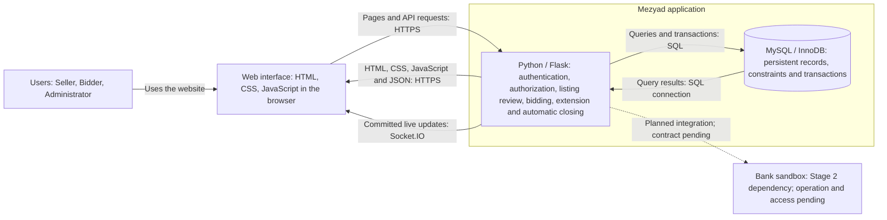
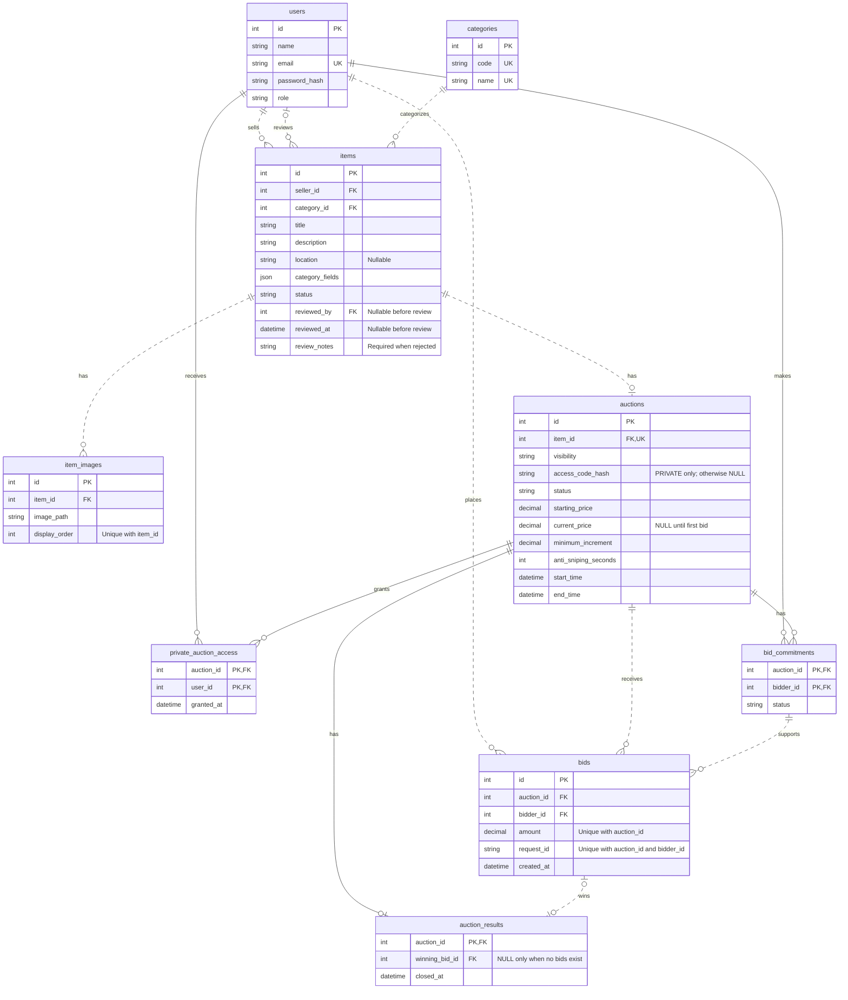
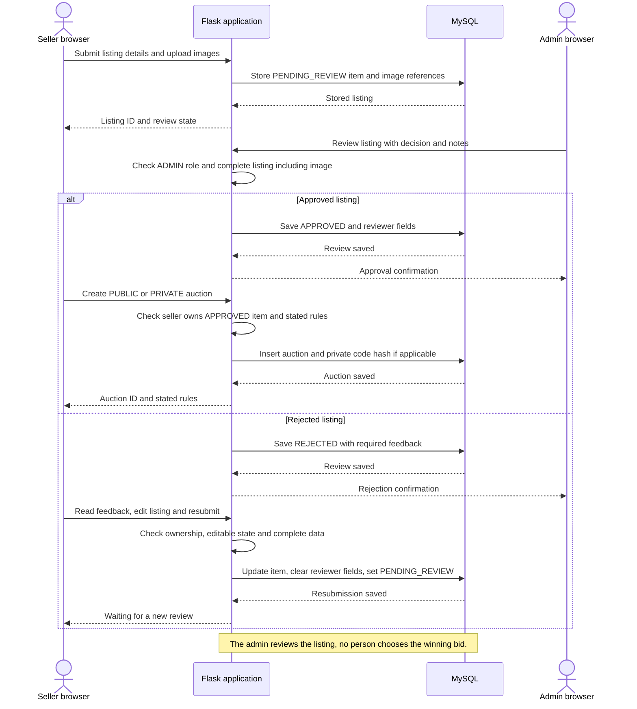
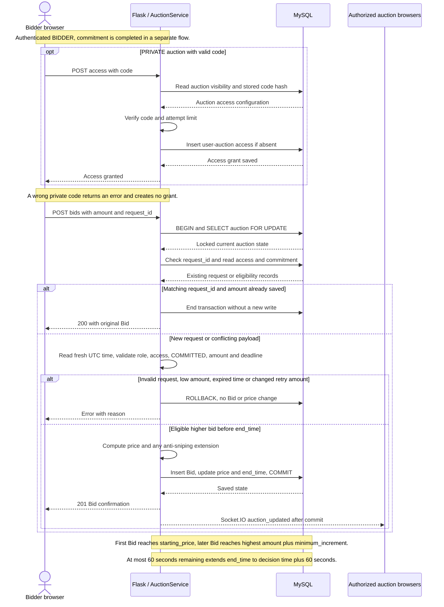
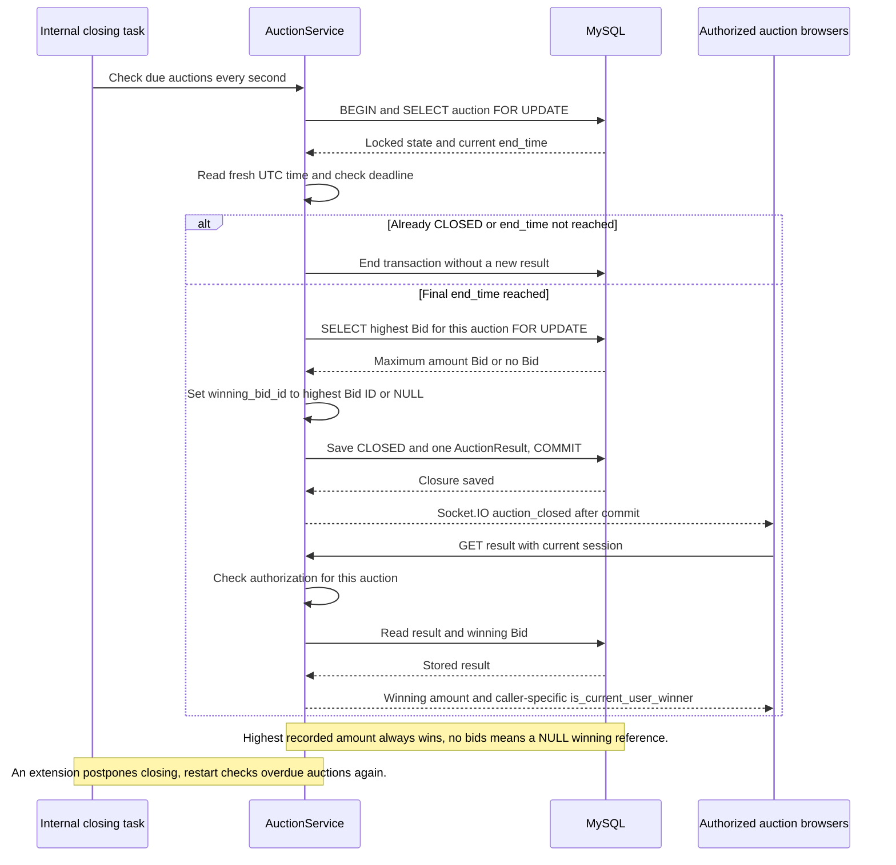

# Mezyad — Stage 3: Technical Documentation

**Project:** Mezyad | مزياد — منصة مزاد للأصول ذات القيمة العالية.  
**Team:** Aseel Alzhrani, Ghadi Alzhrani, Tala Alhudhaybi, Abeer Alsayari.  
**Level:** Holberton Novice — أربعة أعضاء، تطبيق ويب واحد وقاعدة بيانات واحدة.  
**Version:** 10 October 2026 — مقترح تقني جديد للمراجعة في ريبو testing-mz.

## هدف الوثيقة ونطاق MVP

هذه وثيقة بناء كاملة لمرحلة Stage 3، تربط المتطلبات بقصص المستخدم والشاشات والمعمارية والكلاسات وقاعدة البيانات وتسلسلات العمليات والـAPI وخطة إدارة الكود والاختبار. تستند إلى Stage 1 وStage 2 والتقرير السابق عند commit `57929bf0942be798a4aa7527827b88f5b25d88fc`، وإلى ملاحظات الفريق وملخص ملاحظات المشرف الذي قدمته غادي. التصميم خطة تنفيذ للطلاب؛ التطبيق لم يُبنَ أو يُختبر في هذا الريبو بعد.

المسار الرئيسي: تسجيل/دخول → إعلان أصل ومعلوماته وصوره → مراجعة المشرف → إنشاء مزاد عام أو خاص → وصول المزايد والتزامه → مزايدات مباشرة وتمديد النهاية عند الحاجة → إغلاق تلقائي وفوز أعلى مبلغ مسجل. تنتهي مسؤولية MVP عند عرض النتيجة. الدفع والتسوية والتسليم والعمولات المالية خارج هذا المسار.

تشمل الواجهة الحالية السيارات والعقارات والإبل واللوحات. تضاف هذه الفئات الأربع إلى بيانات الاختبار نفسها حتى تتطابق الشاشات والـAPI والبيانات. تعد الأفكار الأوسع في Stage 1 تاريخًا للفكرة، ولا تتحول تلقائيًا إلى وظائف إضافية في MVP.

| متطلب Stage 3 | موضعه في التقرير |
|---|---|
| Task 0: User Stories and Mockups | القسم 1: MoSCoW، معايير قبول، وربط الشاشات بالقصص |
| Task 1: System Architecture | القسم 2: المسؤوليات والتقنيات والأسهم، ومخطط Architecture واحد |
| Task 2: Components, Classes, Database | القسم 3: الكلاسات والواجهة، والقسم 4: ERD وschema.sql |
| Task 3: Sequence Diagrams | القسم 5: ثلاثة تسلسلات للعمليات الأساسية |
| Task 4: External and Internal APIs | القسم 6: paths/methods/input/output والأحداث وعقد البنك غير المحسوم |
| Task 5: SCM and QA | القسم 7: Git/Docker/staging/production، والقسم 8: الاختبارات وManual QA |
| Task 6: Complete deliverable and justifications | القسم 9: مبررات التصميم، والقسم 10: شروط اعتماد التسليم |

يوجد خمسة مخططات فقط، بكود Mermaid داخل Markdown: Architecture، ERD، وثلاثة Sequence Diagrams. وصف الكلاسات والـSCM والـQA جداول ونص؛ mockups الواجهة في Figma.

## 1. User Stories and Mockups — Task 0

| MoSCoW | User Story |
|---|---|
| Must | As a user, I want to register and sign in securely, so that I can use the functions allowed for my role. |
| Must | As a seller, I want to submit an asset listing, so that an administrator can review its information before publication. |
| Must | As a seller, I want to revise and resubmit a returned listing, so that I can correct its information. |
| Must | As an administrator, I want to approve or return a listing with feedback, so that published assets have clear information. |
| Must | As a seller, I want to create a public or private auction with stated rules, so that authorized bidders can compete fairly. |
| Must | As a bidder, I want to verify a private code and complete commitment, so that I can participate in that auction. |
| Must | As a bidder, I want to place higher bids and see live price/time updates on one page, so that I can follow the auction. |
| Must | As a bidder, I want late bids to extend the stated end time, so that participants have time to respond. |
| Must | As a participant, I want the highest recorded bid to win automatically at the final deadline, so that the result follows the rules. |
| Should | As a user, I want assistant suggestions and summaries, so that I can understand listings and auction activity. |
| Could | As a bidder, I want extra public search filters, so that I can narrow results. |
| Won't | Online payments, escrow, invoicing, delivery, paid bidding attempts, distributed infrastructure and external generative AI. |

Should للمساعد ترتيب تنفيذ بعد الجوهر، وليس حذفًا لمتطلب Stage 2. روابط الواجهة الحالية: [Figma UI Prototype](https://www.figma.com/proto/mbc0Qc5e0hR8dIaqQjbMMN/Mezyad-1?node-id=2-2&starting-point-node-id=2%3A2) و[Figma Make](https://www.figma.com/make/kPPjEPSCp5baGlCi8Lz2o4/Mezyad-1?t=Z7jnPTxHHkYSNbgS-20&fullscreen=1).

Mockups الحالية في Figma والسيناريوهات السبعة تبقى مرجع الواجهة، ومنها إعادة الإعلان وإغلاق مزاد بلا مزايدات. لا يحل ERD محل mockups.


### معايير قبول مرتبطة بقصص المستخدم

| ID | الأولوية | معيار قبول يمكن تجربته |
|---|---|---|
| US01 — Registration/login | Must | يسجل SELLER أو BIDDER ببريد فريد؛ لا يسمح التسجيل العام بـADMIN؛ تظهر بيانات الحساب دون password_hash. |
| US02 — Listing | Must | يربط الخادم الإعلان بالبائع الحالي؛ يحفظ بيانات الفئة والصور؛ لا يدخل ناقص الصورة/الحقول في طابور المراجعة. |
| US03 — Revision | Must | يرى المالك سبب الرفض؛ يعدل الإعلان ويعيد إرساله؛ تزال بيانات المراجعة السابقة وتعود الحالة PENDING_REVIEW. |
| US04 — Review | Must | يسمح ADMIN وحده بالمراجعة؛ الرفض يحتاج ملاحظة؛ مراجعة إعلان غير PENDING_REVIEW تعطي 409. |
| US05 — Publish | Must | ينشر المالك Item APPROVED فقط، مرة واحدة، بقواعد سعر وزمن صحيحة؛ الخاص لا يظهر في القائمة العامة. |
| US06 — Private access | Must | الرمز الصحيح يمنح وصول المستخدم لذلك المزاد فقط؛ الخاطئ لا ينشئ وصولًا؛ الالتزام شرط منفصل عن الرمز. |
| US07 — Bidding | Must | أول مبلغ يبلغ سعر البداية؛ اللاحق يبلغ الحد الأدنى الجديد؛ الطلب المكرر لا يسجل Bid ثانية؛ متصفحان يعرضان السعر المحفوظ. |
| US08 — Anti-sniping | Must | مزايدة صحيحة خلال آخر 60 ثانية تجعل النهاية وقت قبول الخادم +60 ثانية، ويرى المتصفحان النهاية الجديدة. |
| US09 — Result | Must | يغلق الخادم عند النهاية الحالية؛ يفوز أعلى Bid تلقائيًا؛ بلا Bids تحفظ نتيجة بلا فائز؛ لا اختيار فائز بشري. |
| US10 — Assistant | Should | الوظائف الست تستخدم المعلومات الموجودة، ولا تصنع مبالغ أو تختار مزايدة أو تكشف مزادًا خاصًا لغير المصرح. |
| US11 — Search filters | Could | يمكن إضافة مرشحات عامة بعد نجاح المسار الرئيسي؛ لا يتوقف MVP عليها. |

### الشاشات المطلوبة وربطها بالمكونات

| الشاشة / المرجع | العناصر والتفاعل المطلوب | القصص |
|---|---|---|
| التسجيل والدخول | AuthenticationForm، أخطاء الحقول، توجيه حسب الدور | US01 |
| قائمة المزادات العامة | AuctionList، بطاقات الأصل والسعر والوقت، بحث وفئة؛ الدخول مطلوب في نطاق Stage 2 | US05/US11 |
| إنشاء الإعلان / إعادته | ListingForm، حقول الفئة، صور، حالة وملاحظات؛ AssistantPanel يقدّم اقتراحًا قابلًا للتعديل | US02/US03/US10 |
| مراجعة المشرف | ReviewPanel، معلومات وصور، approve/reject وملاحظات | US04 |
| إعداد المزاد | وقت البداية والنهاية والسعر والزيادة ونوع الوصول؛ رمز خاص عند PRIVATE | US05 |
| صفحة المزاد الواحدة | AuctionDetails + PrivateAccessForm + CommitmentPanel + BidForm + BidHistory + عداد ونتيجة + AssistantPanel | US06–US10 |
| النتيجة داخل صفحة المزاد | AuctionResultPanel يميز فوز المستخدم/خسارته/عدم وجود مزايدات؛ يتوقف BidForm | US09 |

الـmockups الموجودة والمشار إليها في الروابط أعلاه مرجع بصري. قبل التنفيذ يراجع الفريق خصوصًا سيناريو إرجاع الإعلان وإغلاق مزاد بلا مزايدات، ويعدل أي شاشة تسمح باختيار الفائز يدويًا. إضافة رمز Mermaid لا تقوم مقام mockups الشاشة.

## قواعد العمل والصلاحيات التي تربط الأقسام

1. الأدوار الحالية BIDDER وSELLER وADMIN، دور واحد للحساب. التسجيل العام لا يسمح بإنشاء ADMIN.
2. الإعلان PENDING_REVIEW ثم APPROVED أو REJECTED. يبدأ حفظ البيانات ثم رفع الصور؛ لا يعرض في طابور المراجعة ولا يعتمد إلا بعد اكتمال الحقول وصورة واحدة على الأقل. البائع يعدل إعلانًا أعيد له ثم يعيد إرساله؛ تمسح حقول المراجعة الحالية وتعود الحالة PENDING_REVIEW.
3. ينشأ المزاد لإعلان APPROVED يملكه البائع فقط. لكل إعلان صفر أو مزاد واحد في MVP؛ إعادة المزاد للإعلان نفسه خارج هذه النسخة.
4. الخاص له رمز مخزن كـhash. بعد التحقق الآلي يسجل الوصول الخاص للمستخدم والمزاد. لا توجد موافقة بشرية على Bid.
5. صلاحية الخاص تشمل الإعلان والصور والمساعد والانضمام لقناة التحديث، بالإضافة إلى صفحة المزاد. المالك والمشرف لهما صلاحية عملهما.
6. الالتزام منفصل عن الوصول الخاص، ولكل مزايد ومزاد. لا يثبت الجدية أو القدرة المالية؛ عملية البنك لم تُحسم.
7. أول مبلغ ≥ starting_price. كل مبلغ لاحق ≥ أعلى مبلغ مسجل + minimum_increment. لا تسجل مبالغ متساوية، ولا يختار شخص بين المزايدات.
8. إذا سجلت مزايدة قبل النهاية وكان المتبقي ≤ 60 ثانية، يصبح end_time = وقت قرار الخادم + 60 ثانية. يتكرر التمديد عند تحقق الشرط.
9. وقت الخادم هو المرجع؛ عداد المتصفح للعرض. عند النهاية النهائية يفوز الأعلى تلقائيًا. عند عدم وجود مزايدات تحفظ نتيجة بلا winning_bid_id.
10. لا يوجد تعديل أو حذف للمزايدات المسجلة والنتيجة، ولا تعديل لبيانات الأصل المنشور خلف المزايدين.

## 2. System Architecture — Task 1

المعمارية المقترحة تطبيق ويب واحد بتنظيم مسؤوليات داخله (layered monolith): عرض الواجهة، قواعد العمل، والوصول للبيانات. هذا نمط عام موثق، وليس افتراض أنكم تبنون نظامًا موزعًا. استفدت من مبادئ C4 في تسمية العنصر ومسؤوليته وتقنيته وتسمية الأسهم، مع فصل تفاصيل Docker والنشر. الرسم ليس ادعاء تطبيق كل مستويات C4، ولا أن التاسك يفرض C4.

هذه الوثيقة تحتوي خمسة مخططات مطلوبة بصيغة Mermaid: Architecture واحد، ERD واحد، وثلاثة Sequence Diagrams. وصف الكلاسات جدول هنا، وSCM وDocker وQA خطط نصية. لا توجد رسومات إضافية لها في النسخة المسلمة.

المتصفح يعرض HTML/CSS/JavaScript ويطلب Flask عبر HTTP. Flask يتحقق من الهوية والصلاحية وقواعد العمل، ثم يقرأ ويكتب MySQL. الأحداث المباشرة ترجع من التطبيق إلى المتصفحات بعد الحفظ. لا يتصل المتصفح مباشرة بقاعدة البيانات، ولا يقرر السعر أو الفائز.

داخل تطبيق Flask: routes، نماذج SQLAlchemy لربط كلاسات Python بالجداول، AuctionService للمزايدة والإغلاق، وظائف مراجعة الإعلان، وظائف المساعد، ووحدة البنك عند تحديد العملية. هذه أجزاء تطبيق واحد وليست خدمات مستقلة.

Socket.IO يخدم عرض السعر والوقت في صفحة المزاد نفسها. لا يحل محل SQL أو transaction. تشغيل MVP بعملية تطبيق واحدة وعامل خادم واحد يدعم threads؛ يمكن استخدام Gunicorn threaded مع simple-websocket داخل حاوية Linux. لا نضيف عدة نسخ تطبيق دون مراجعة توزيع الأحداث ومهمة الإغلاق. لا نستخدم Flask development server كخطة production.

المساعد يحتفظ بوظائفه الست: اقتراح العنوان، نقص الحقول، بحث العام، ملخص النشاط، خط المزايدات الزمني، وملخص المزاد. تنفيذها قواعد واستعلامات؛ لا تتطلب خدمة AI خارجية.

### Architecture Diagram



الخط المنقط اعتماد خارجي لم يُحسم عقده. Docker وGitHub موضحان في خطة SCM والنشر، ولا يتوسطان طلبات المستخدم.

## 3. Components and Classes — Task 2

| Class → table | خصائص أساسية | Methods |
|---|---|---|
| User → users | id,name,email,password_hash,role | set_password(), check_password() |
| Category → categories | id,code,name | لا قواعد مستقلة تحتاج methods مصطنعة. |
| Item → items | seller_id,category_id,title,status,reviewed_by,category_fields | can_edit(), resubmit() |
| ItemImage → item_images | id,item_id,image_path,display_order | الرفع والتحقق في route/helper. |
| Auction → auctions | item_id,visibility,status,starting_price,current_price,minimum_increment,start_time,end_time | is_open(now), minimum_next_amount() |
| PrivateAuctionAccess → private_auction_access | auction_id,user_id,granted_at | لا business methods مستقلة. |
| BidCommitment → bid_commitments | auction_id,bidder_id,status | is_committed() |
| Bid → bids | id,auction_id,bidder_id,amount,request_id,created_at | سجل ثابت، لا update/delete. |
| AuctionResult → auction_results | auction_id,winning_bid_id,closed_at | نتيجة ثابتة؛ لا choose_winner(). |
| AuctionService — لا table | db_session | ensure_access(), place_bid(), close_if_due() |

AuctionService يعتمد على النماذج. ليس User والدور BIDDER وراثة أو تركيبًا. طرق Item تغير الحالة بعد فحص الملكية. قرار حفظ Bid يستخدم قراءة مقفلة داخل المعاملة، وليس نتيجة is_open من قراءة قديمة.

الواجهة: AuthenticationForm، AuctionList، AuctionDetails، PrivateAccessForm، CommitmentPanel، BidForm، BidHistory، AuctionResultPanel، ListingForm، ReviewPanel، AssistantPanel. هي أقسام HTML/JS؛ لا تعني استخدام React. السعر والعداد والنموذج والسجل والنتيجة في صفحة المزاد نفسها. بعد انقطاع الاتصال يجلب المتصفح snapshot من GET؛ الأحداث ليست مصدر الحقيقة.


### تنظيم الملفات ومسؤوليات الكود

هذا تقسيم ملفات داخل التطبيق الواحد، وليس خوادم متعددة. أسماء الملفات خطة Stage 4.

| المكان المقترح | المسؤولية |
|---|---|
| app/__init__.py | إنشاء تطبيق Flask وتهيئة config وSQLAlchemy وSocket.IO |
| app/models.py | الكلاسات التسع التي تطابق الجداول، دون توريث User إلى Seller/Bidder/Admin |
| app/routes/auth.py | التسجيل والدخول والخروج وقراءة الجلسة |
| app/routes/items.py | إعلانات البائع والصور والمراجعة وإعادة الإرسال |
| app/routes/auctions.py | القراءة والوصول الخاص والالتزام والمزايدات والنتيجة |
| app/auction_service.py | معاملات قبول Bid والتمديد والإغلاق؛ هو المكان الواحد لهذه القواعد |
| app/assistant.py | اقتراحات قواعد بسيطة واستعلامات الوظائف الست |
| app/bank_adapter.py | عزل طلب Sandbox عند تحديد عقده؛ لا يقرر الفائز |
| app/closing_task.py | مهمة واحدة لبداية/نهاية المزادات واستدراكها بعد إعادة التشغيل |
| app/templates/ + app/static/ | Jinja/HTML وCSS وJavaScript؛ JS يتعامل مع JSON والأحداث |
| migrations/ + tests/ | تغييرات schema واختبارات قواعد العمل والتكامل |

SQLAlchemy يربط كلاسات Python بالجداول. `db_session` وحدة العمل في AuctionService، ويجب أن تعيش المعاملة كلها في الجلسة نفسها. لا ننشئ كلاسًا لكل شاشة أو حالة أو جدول بلا مسؤولية فعلية. الخصائص المذكورة في جدول الكلاسات أساسية، والتعريف الكامل للحقول في schema.sql.

| مكون الواجهة | كيف يتواصل وكيف يحدّث الشاشة |
|---|---|
| AuthenticationForm | POST auth/register أو auth/login، ثم قراءة auth/me وتوجيه المستخدم |
| ListingForm / ReviewPanel | POST/PATCH item ورفع الصور؛ قراءة الحالة؛ إجراء review للمشرف فقط |
| AuctionList / AuctionDetails | GET auctions وGET auction snapshot؛ لا يقرأ MySQL مباشرة |
| PrivateAccessForm / CommitmentPanel | نجاح access يمنح الوصول؛ نجاح commitment يمنح شرط المزايدة؛ لا يكفي أحدهما بدل الآخر |
| BidForm / BidHistory | POST amount/request_id؛ عرض خطأ واضح أو تحديث الـsnapshot؛ لا يرفع السعر محليًا قبل نجاح الحفظ |
| AuctionResultPanel | عند auction_closed يجلب result الخاص بالجلسة ويوقف المزايدة |
| AssistantPanel | استدعاء وظيفة محددة وعرض اقتراح؛ تظل القرارات للمستخدم |

## 4. Database Design — Task 2

SQL يستهدف MySQL 8.4/InnoDB؛ المخطط الكامل في [schema.sql](schema.sql). تسعة جداول؛ جلسة Flask الموقعة لا تحتاج جدول user_sessions. الدور الحالي يقرأ من users في الخادم. لا تحفظ أسرار المزاد أو بيانات البنك في cookie.

| الجدول | المسؤولية |
|---|---|
| users | الحساب والدور وكلمة المرور كـhash. |
| categories | الفئات نفسها في الواجهة والـAPI والبيانات التجريبية: سيارات وعقارات وإبل ولوحات. |
| items | الأصل وبائعه وفئته ومعلوماته وحالة وآخر ملاحظات المراجعة. |
| item_images | صورة ومسارها وترتيبها لكل إعلان؛ عدة صور للأصل. |
| auctions | النوع والوقت والشروط والسعر الحالي. البائع يستخرج من item ولا يكرر هنا. |
| private_auction_access | صلاحية user لمزاد خاص، بمفتاح مركب. |
| bid_commitments | التزام bidder بمزاد، بمفتاح مركب. |
| bids | سجل كل مبلغ وصاحبه ومزاده ووقته ومعرف إعادة الطلب. |
| auction_results | نتيجة واحدة للمزاد، تربط winning_bid_id. الاسم والمبلغ يستخرجان من Bid/User. |

في ERD: || تعني واحدًا إلزاميًا؛ o| و|o تعنيان صفرًا أو واحدًا؛ o{ تعني صفرًا أو عدة. الخط المتصل علاقة identifying تدخل فيها هوية الأب في مفتاح الابن، والمنقط علاقة non-identifying. هذه خطوط علاقات بيانات وليست رسائل شبكة.

| العلاقة | التفسير الصحيح |
|---|---|
| User—Item (seller) | لكل Item بائع واحد؛ User له صفر أو عدة إعلانات. |
| User—Item (reviewer) | للإعلان صفر أو مراجع واحد قبل/بعد المراجعة؛ المشرف يراجع عدة إعلانات. |
| Category—Item | للإعلان فئة واحدة؛ الفئة تحتوي صفر أو عدة إعلانات. |
| Item—ItemImage | الصورة تخص إعلانًا واحدًا. قد يبدأ سجل الإعلان بلا صور أثناء الإدخال؛ التطبيق يشترط صورة قبل إرساله للمراجعة. |
| Item—Auction | لكل Auction إعلان واحد؛ Item له صفر أو مزاد واحد. UNIQUE(item_id). |
| User/Auction—PrivateAuctionAccess | كل صف يربط مستخدمًا واحدًا ومزادًا واحدًا، وPK الزوج يمنع التكرار. لا نلزم العام بهذا السجل. |
| User/Auction—BidCommitment | سجل واحد لكل زوج مزايد/مزاد، وليس سجلًا لكل Bid. |
| User/Auction—Bid | لكل Bid مزايد واحد ومزاد واحد؛ كل منهما له صفر أو عدة Bids. |
| BidCommitment—Bid | FK مركب يربط الالتزام بنفس bidder وauction. الخادم يفحص COMMITTED؛ وجود الصف وحده لا يكفي. |
| Auction—AuctionResult | صفر أو نتيجة واحدة أثناء دورة الحياة. التطبيق ينشئ واحدة عند الإغلاق؛ PK(auction_id) يمنع نتيجتين. |
| Bid—AuctionResult | صفر أو Bid فائز لكل نتيجة بسبب حالة بلا مزايدات. كل Bid فائز في صفر أو نتيجة واحدة. FK مركب يمنع Bid من مزاد آخر. |

SQL لا يثبت أن user بائع أو مشرف، ولا أن winning_bid هو الأعلى. FK يثبت وجود المرجع؛ الخادم يفحص الأدوار والحالات ويحسب الفائز داخل transaction.

حقول NULL: reviewed_by/reviewed_at قبل المراجعة؛ review_notes لازمة عند REJECTED؛ access_code_hash للخاص فقط؛ current_price قبل أول Bid؛ winning_bid_id عند الإغلاق بلا مزايدات فقط. المبلغ DECIMAL(18,2)، وDecimal في Python، ونص في JSON. IDs أعداد INT؛ request_id UUID لكل محاولة إرسال؛ الأوقات UTC.

UNIQUE(auction_id,bidder_id,request_id) يمنع إعادة حفظ الطلب نفسه. إعادة نفس المفتاح بمبلغ مختلف conflict. UNIQUE(auction_id,amount) يمنع التعادل المسجل، لكنه لا يكفي للتحقق من أقل زيادة. السعر الحالي قيمة مشتقة تحدث في transaction مع Bid؛ لا تقبل من المتصفح.

category_fields يحتفظ بخصائص صغيرة متغيرة حسب الفئة كـJSON؛ لا يحوي العلاقات أو الملكية أو السعر. السيارات: make/model/year/mileage/condition؛ العقارات: propertyType/area/bedrooms/condition، والموقع في items.location. حقول الإبل واللوحات المقترحة موضحة في قاموس الفئات أدناه وتراجع مع الفريق. الصور تحفظ خارج static وتقدم عبر route يفحص الوصول.

### Database ER Diagram



المفاتيح المركبة توضح في SQL: PK للزوج في access/commitments، وFK للالتزام بنفس auction/bidder، وFK للنتيجة بنفس auction/winning_bid. PK(auction_id) يمنع نتيجتين للمزاد. الاختيار الأعلى وصلاحيات الأدوار مسؤولية الخادم.


### قاموس البيانات والقيود

التعريف التنفيذي المقترح، بكل الأعمدة وأنواع SQL وNOT NULL وCHECK وFK وUNIQUE، في [schema.sql](schema.sql). ERD يعرض حقول العمل الأساسية؛ timestamps التقنية موثقة في SQL. لا توجد collections منفصلة أو قاعدة NoSQL.

| المجموعة | النوع / القاعدة |
|---|---|
| id وحقول المراجع | INT UNSIGNED؛ المفاتيح الأجنبية من النوع نفسه؛ id تلقائي عدا جدولَي الربط والنتيجة |
| name/email/password_hash | VARCHAR(120/254/255)؛ email فريد ويطبع بصيغة lowercase قبل التسجيل؛ password_hash لا يعاد للواجهة |
| title/description/location | VARCHAR(200)/TEXT/VARCHAR(150)؛ title وdescription إلزاميان؛ location إلزامي للعقار وفق تحقق التطبيق |
| المبالغ | DECIMAL(18,2)؛ موجبة؛ Decimal في Python؛ نصوص عشرية بحد أقصى منزلتين في JSON؛ SAR عملة MVP الوحيدة |
| الأوقات | DATETIME(6) بالقيمة UTC؛ API يعيد ISO 8601 مع Z؛ end_time أكبر من start_time |
| حالات الإعلان | PENDING_REVIEW/APPROVED/REJECTED؛ reviewed_by وreviewed_at معًا بعد المراجعة؛ notes إلزامية للرفض |
| حالات المزاد | SCHEDULED/ACTIVE/CLOSED؛ الوصول يعتمد على الزمن وقواعد الخادم مع الحالة |
| الصور | مسار ملف يختاره الخادم، وليس مسارًا محليًا من المستخدم؛ UNIQUE(item_id,display_order) |
| الحذف | FK ON DELETE RESTRICT يحفظ تاريخ المزايدات؛ لا DELETE للـBid أو AuctionResult في MVP |

تطبع أسماء حقول الفئات بالصيغة نفسها في الواجهة والـAPI. المقترح التالي يكمل الفئات الأربع دون جدول لكل وصف صغير؛ حقول السيارات والعقارات مستمدة من Stage 2، والإبل واللوحات تعريف مبسط مقترح يحتاج مراجعة الفريق مع الشاشات:

| category code | category_fields المطلوبة | اختيارية / التحقق |
|---|---|---|
| vehicles | make,model,year,mileage,condition | year عدد صحيح منطقي للموديل؛ mileage عدد صحيح ≥0؛ condition وصف غير فارغ |
| real_estate | propertyType,area,bedrooms,condition | area نص عشري موجب بالمتر المربع؛ bedrooms عدد صحيح ≥0؛ location في items وليس مكررًا في JSON |
| camels | breed,sex,age_months | name وhealth_notes اختياريان؛ sex=MALE/FEMALE؛ age_months عدد صحيح ≥0؛ الوصف من البائع ولا يعد تحققًا طبيًا |
| plates | plate_text | plate_type اختياري؛ plate_text نص غير فارغ مثل "ن ج د 1"؛ لا تحوّل حروف اللوحة إلى حقول مستخدم أو رقم حساب |

الـJSON يحتفظ بخصائص الأصل فقط، ولا يحفظ seller أو bidder أو bids أو نتيجة أو علاقات. لا يكرر موقع العقار أو بيانات المزاد. هذه المفاضلة مناسبة لفئات قليلة وحقول وصفية صغيرة؛ لو أضيف بحث معقد مستقل لكل فئة مستقبلًا يعاد تقييمها بدل توسيع JSON بلا ضابط. أي مفتاح غير معروف يرفضه تحقق الفئة.

مثال: أعلى Bid في auction 7 مبلغه 1500.00. النتيجة تحفظ auction_id=7 وwinning_bid_id لذلك الـBid. لا تحفظ winner_id أو winning_amount مكررين، ولا تسمح FK المركبة بربط Bid من auction 8. `current_price` استثناء مشتق مقصود لعرض السعر؛ يحدث مع Bid في المعاملة نفسها، ويمكن مقارنته بأعلى Bid في اختبار التكامل.

## 5. High-Level Sequence Diagrams — Task 3

1. الإعلان → مراجعة المشرف → إنشاء المزاد. عند REJECTED: ملاحظات ثم PATCH وresubmit؛ لا ينشر إعلان غير معتمد. مخطط النجاح لا يخفي هذا الفرع الموثق.
2. دخول خاص → التزام مكتمل → POST للمزايدة → lock/validation/save/commit → تحديث السعر والنهاية. للعام تتجاوز خطوة الرمز فقط. البنك مرحلة منفصلة لم يحدد عقدها، وليس استدعاء داخل قفل Bid.
3. مهمة داخل التطبيق → lock وفحص الموعد الحالي → أعلى Bid أو لا Bid → كتابة CLOSED ونتيجة واحدة → حدث الإغلاق. التمديد يجعل المهمة تنتظر الموعد الجديد.

مهمة داخلية واحدة كل ثانية في عملية التطبيق الواحدة، ولا تحتاج متصفحًا مفتوحًا. تنقل SCHEDULED إلى ACTIVE عند start_time، وتغلق المزاد عند end_time الحالي، بقفل صفه داخل المعاملة. تستدرك المزادات المنتهية بعد restart؛ إذا فات وقت البداية والنهاية تغلقه مباشرة. GET وPOST يتحققان من الوقت الحالي ويستخدمان close_if_due كفحص إضافي؛ حالة ACTIVE وحدها لا تسمح بالمزايدة بعد الموعد. يمنع تشغيل المهمة مرتين بسبب development reloader.

place_bid: الهوية من الجلسة → transaction وقفل صف Auction → كشف إعادة الطلب → قراءة وقت UTC جديد بعد الحصول على القفل → فحص الوقت والوصول والالتزام والمبلغ → حفظ Bid وتحديث السعر والنهاية → commit → بث الحدث. close_if_due يقفل الصف نفسه. تقرأ بيانات المزاد المقفلة من الخادم وتعيد تحميلها إذا كانت SQLAlchemy تحتفظ بنسخة سابقة. يقرأ الطلب المكرر وأعلى Bid قراءة مقفلة حديثة داخل المعاملة، حتى لا يعتمد القرار على snapshot قديم في MySQL. لكل طلب أو thread جلسة SQLAlchemy مستقلة؛ جلسة مهمة الإغلاق لا تشارك جلسة طلب متصفح. يجب اختبار تزامن المزايدة والإغلاق؛ وضع كلمة transaction في الرسم لا يثبت الصحة.

### Sequence 1 — Listing review and publication



### Sequence 2 — Private access and bidding



### Sequence 3 — Automatic closing



## 6. External and Internal APIs — Task 4

JSON للأعمال المعتادة، multipart للصور، cookie session وحماية CSRF لطلبات التغيير. user IDs للعمل مشتقة من الجلسة؛ لا يرسل المتصفح seller_id أو bidder_id أو reviewed_by أو current_price أو الفائز. لا ينشئ تسجيل الحساب ADMIN.

| Method / Path | Input | Output / access |
|---|---|---|
| POST /api/v1/auth/register | name,email,password,role=SELLER/BIDDER | 201: id,name,role |
| POST /api/v1/auth/login | email,password | 200: user + session cookie |
| POST /api/v1/auth/logout | فارغ | 204 |
| GET /api/v1/auth/me | فارغ | user أو 401 |
| GET /api/v1/categories | فارغ | categories[] |
| POST /api/v1/items | category_id,title,description,location,category_fields | 201: item/status؛ SELLER، استكمال الصور قبل المراجعة |
| GET /api/v1/items/{id} | path | item؛ مالك/ADMIN أو عبر مزاد يحق للمستخدم رؤيته |
| PATCH /api/v1/items/{id} | الحقول المعدلة | item؛ المالك وPENDING_REVIEW/REJECTED قبل الاعتماد فقط |
| POST /api/v1/items/{id}/images | file | 201: image؛ المالك قبل الاعتماد/النشر |
| GET /api/v1/item-images/{id} | path | الصورة بعد فحص الوصول |
| POST /api/v1/items/{id}/resubmit | فارغ | PENDING_REVIEW بعد اكتمال الحقول وصورة واحدة على الأقل |
| GET /api/v1/admin/items?status= | query | items[]؛ ADMIN، لا يدخل ناقص الصور في قائمة المراجعة |
| POST /api/v1/items/{id}/review | decision,notes | item/status؛ ADMIN؛ notes لازمة للرفض |
| POST /api/v1/auctions | item_id,visibility,starting_price,minimum_increment,start_time,end_time,access_code للخاص | 201: auction؛ مالك Item APPROVED |
| GET /api/v1/auctions?category_id=&q= | query | public auctions[]؛ الدخول مطلوب كما في Stage 2 |
| GET /api/v1/auctions/{id} | path | auction,item,bids,server_time؛ فحص الخاص |
| POST /api/v1/auctions/{id}/access | code | access_granted؛ BIDDER، تحقق رمز مع حد للمحاولات |
| POST /api/v1/auctions/{id}/commitment | يعتمد على عملية البنك المختارة | commitment.status؛ العقد غير نهائي |
| POST /api/v1/auctions/{id}/bids | amount كنص,request_id UUID | 201: bid,auction؛ 200 لإعادة مطابق؛ ملتزم ومصرح |
| GET /api/v1/auctions/{id}/result | path | status,winning_bid_id/amount nullable,is_current_user_winner؛ 409 قبل الإغلاق |

400 مدخل غير صالح، 401 دخول، 403 صلاحية، 404 غير موجود، 409 تعارض الحالة/السعر/إعادة الطلب. قالب الخطأ: `{ "error": { "code": "BID_TOO_LOW", "message": "..." } }`.
طلب Bid: `{ "amount": "1500.00", "request_id": "6a550a11-14e0-4fa2-9806-e8a5d7fbfc23" }`.
استجابة: `{ "bid": { "id": 42, "auction_id": 7, "amount": "1500.00" }, "auction": { "current_price": "1500.00", "end_time": "2026-10-10T15:01:00Z" } }`.
بلا مزايدات: `{ "status": "CLOSED", "winning_bid_id": null, "winning_amount": null, "is_current_user_winner": false }`.

Socket.IO: join_auction {auction_id} يفحص الجلسة والوصول ويعيد snapshot. auction_updated {auction_id,current_price,end_time,status} وauction_closed {auction_id,status} بعد commit. عند الإغلاق يجلب كل مستخدم GET result؛ لا نبث قيمة is_current_user_winner الشخصية للجميع. لا تستخدم Socket.IO لكتابة المزايدة بدل POST.

المساعد: POST `/api/v1/assistant/title` و`/missing-fields` ببيانات الإعلان للمالك؛ GET `/api/v1/assistant/search?q=` للعام؛ GET `/api/v1/auctions/{id}/assistant/activity-summary` و`/bid-timeline` و`/auction-summary` لمن يملك الوصول. النتائج title/missing_fields/auctions/summary/timeline حسب الوظيفة؛ عقود الوظائف الست التفصيلية موضحة أدناه.

Stage 2 يطلب Saudi Open Banking sandbox ويذكر SABB وAl Rajhi بديلًا. لا عقد عملية أو وصول مثبت في الريبو. يجب اختيار عملية موثقة ومدخلها ومخرجها وأثرها على الالتزام، أو تعديل المتطلب مع الموجه. لا نختلق endpoint أو نزعم اكتمال الربط. mock أثناء التطوير لا يثبت نجاح التكامل الخارجي.


### قواعد عقد JSON

المسارات أعلاه تحت `/api/v1`. POST/PATCH يستخدمان `Content-Type: application/json`، عدا الصور `multipart/form-data`. تقبل المبالغ كنصوص decimal فقط، والـIDs أعدادًا صحيحة موجبة، والأوقات ISO 8601 UTC. عدم إرسال حقل إلزامي يعطي 400. الحقول التي يحددها الخادم (id/owner/price/status/winner) لا يسمح بتغييرها من المتصفح. الطلب الخالي يستخدم `{}`، و204 ليس له JSON.

جلسة Flask في Cookie موقعة HttpOnly، وSecure على HTTPS وSameSite=Lax. يظهر CSRF token في صفحة Jinja ويعاد في `X-CSRFToken` لطلبات التغيير؛ لا يوضع token أو secret في Git. تحفظ الجلسة user_id، وتقرأ role الحالية من users. الصور JPEG/PNG فقط وبحد مقترح 5 MB للصورة؛ يتحقق الخادم من نوع الملف ومحتواه ويختار اسمًا جديدًا. تعرض أخطاء 413 للحجم و415 للنوع غير المقبول. توضع كلمة المرور والرمز الخاص في hash ولا تظهر في responses.

قوائم البحث تستخدم page عددًا موجبًا وpage_size من 1 إلى 50 (الافتراضي 20). `q` نص لا يتجاوز 200 حرف. مثال wrapper: `{ "auctions": [], "page": 1, "page_size": 20, "total": 0 }`. شرط صلاحية الخاص يطبق قبل جمع العدد والملخص.

### أشكال البيانات المعادة

الأسماء التالية تعريف لأشكال JSON مشتركة، وليست جداول جديدة. تعاد فقط الحقول التي يحق للجلسة رؤيتها.

| الشكل | الحقول |
|---|---|
| User | id:number, name:string, role:string؛ email للحساب نفسه فقط |
| Category | id:number, code:string, name:string |
| Image | id:number, item_id:number, url:string لمسار item-images, display_order:number |
| Item | id,seller_id,category_id,title,description,location:null/string,category_fields:object,status,images:Image[]؛ review_notes للمالك/ADMIN فقط |
| Auction | id,item_id,visibility,status,starting_price:string,current_price:null/string,minimum_increment:string,anti_sniping_seconds:60,start_time,end_time؛ لا access_code_hash |
| Bid | id,auction_id,amount:string,created_at؛ request_id للمُرسل فقط؛ لا بيانات حساب خاصة للمنافسين |
| Snapshot | auction:Auction,item:Item,bids:Bid[],server_time:string,access_granted:boolean,commitment_status:null/string |
| Result | status:CLOSED,winning_bid_id:null/number,winning_amount:null/string,closed_at:string,is_current_user_winner:boolean |

عقود ردود endpoints: register/login/me تعيد `{ "user": User }` (login ينشئ Cookie). categories تعيد `{ "categories": Category[] }`. عمليات الإعلان والـreview والـresubmit تعيد `{ "item": Item }`. رفع الصورة يعيد `{ "image": Image }`، وقراءة الصورة تعيد bytes بنوع صورة بعد فحص الوصول. إنشاء المزاد يعيد `{ "auction": Auction }`. تفاصيل المزاد تعيد Snapshot. access يعيد `{ "access_granted": true }`. bids يعيد `{ "bid": Bid, "auction": Auction }`. result يعيد Result. admin/items يعيد `{ "items": Item[], "page": 1, "page_size": 20, "total": number }`.

يضاف `GET /api/v1/items/mine` للبائع، بمدخل page/page_size اختياري ورد items[] مع ملخص مزاد كل إعلان إن وجد، كي تعرض لوحة البائع الحالة والإعلانات الخاصة دون كشفها في البحث العام. status في قائمة admin/items قيمة من حالات الإعلان المحددة؛ GET auth/me دون جلسة يعطي 401. نجاح PATCH/review/resubmit/access وقراءات JSON يعطي 200. تضارب البريد أو مزاد ثان للإعلان يعطي 409.

### أمثلة مدخلات واضحة

```json
{
  "category_id": 1,
  "title": "سيارة موديل 2020",
  "description": "وصف حقيقي للحالة والمعلومات المتاحة",
  "location": "الرياض",
  "category_fields": {"make":"Example","model":"Example","year":2020,"mileage":30000,"condition":"used"}
}
```

السجل يربط بالبائع الحالي وحالته PENDING_REVIEW. يرفع البائع الصورة بعد إنشاء Item، فيفحص اكتمال الإعلان قبل ظهوره للمراجعة. يسمح PATCH للمالك في PENDING_REVIEW أو REJECTED قبل الاعتماد، ويمنع تعديل أصل APPROVED أو منشور. review input هو `{ "decision": "APPROVED", "notes": "" }` أو `{ "decision": "REJECTED", "notes": "سبب محدد" }`.

```json
{
  "item_id": 12,
  "visibility": "PRIVATE",
  "starting_price": "1000.00",
  "minimum_increment": "50.00",
  "start_time": "2026-10-11T12:00:00Z",
  "end_time": "2026-10-11T12:30:00Z",
  "access_code": "example-private-code"
}
```

هذا مثال تجريبي وليس رمزًا مستخدمًا. `access_code` من 8 إلى 64 حرفًا؛ للخاص فقط؛ يحفظ hash. البداية المستقبلية تنشئ SCHEDULED، ويعطي وقت غير منطقي 400. حد الدخول المقترح خمس محاولات خاطئة للمستخدم والمزاد خلال خمس دقائق في عملية التطبيق الواحدة؛ تجاوز الحد 429. إعادة تشغيل التطبيق تعيد عداد المحاولات؛ يسجل ذلك كحد للمقترح الطلابي.

### API وظائف المساعد الست

| Method / Path | Input | JSON output / access |
|---|---|---|
| POST /api/v1/assistant/title | category_id,category_fields | `{ "title": "عنوان مقترح" }`؛ SELLER |
| POST /api/v1/assistant/missing-fields | category_id,title,description,location,category_fields | `{ "missing_fields": ["description"] }`؛ SELLER؛ لا تحتاج حفظ Item أولًا |
| GET /api/v1/assistant/search | q,category_id,location,min_price,max_price,page,page_size اختيارية | wrapper auctions للعام فقط؛ جلسة صحيحة |
| GET /api/v1/auctions/{id}/assistant/activity-summary | path | `{ "bid_count": 5, "bidder_count": 3 }`؛ وصول المزاد |
| GET /api/v1/auctions/{id}/assistant/bid-timeline | path | `{ "timeline": [{"minute_start":"2026-10-11T12:01:00Z","bid_count":2}] }`؛ وصول المزاد |
| GET /api/v1/auctions/{id}/assistant/auction-summary | path | `{ "status":"ACTIVE","current_price":"1500.00","bid_count":5,"remaining_seconds":45,"server_time":"2026-10-11T12:29:15Z" }`؛ وصول المزاد |

كل القيم محسوبة من السجلات الحالية. لا توجد توقعات أسعار أو خدمة ذكاء اصطناعي خارجية. لغياب bids: العدادات صفر، timeline فارغ وcurrent_price=null. فلاتر السعر تستخدم current_price إن وجد وإلا starting_price. لا يرسل المستخدم seller_id، ونفس صلاحيات item/auction تنطبق لو أرسل بيانات Item محفوظ.

### الخدمات الخارجية والـSandbox

| الاعتماد | الغرض والاختيار | الحالة / حدود التكامل |
|---|---|---|
| Saudi Open Banking sandbox — SAB/SABB مرشح أساسي، Al Rajhi بديل | شرط Stage 2 داخل Bid Commitment، لبيئة اختبار ببيانات تجريبية | أكد الفريق في 10 أكتوبر عدم وجود وصول أو عملية API محددة. لا URL أو operation أو request/response مصادق عليها بعد. |
| Figma | مرجع الشاشات أثناء التطوير | أداة تصميم؛ لا يستدعيها تطبيق المزاد أثناء الاستخدام. |
| GitHub / Docker | حفظ ومراجعة الكود / تشغيل البيئة | أدوات تطوير ونشر، وليستا API مالية أو طرفًا يختار الفوز. |

عقد البنك الحقيقي لا يمكن إكماله قبل وصول الفريق للوثائق والـSandbox. قبل اعتماده توثق صفحة العملية الرسمية، HTTP method/path، authentication، المدخل والمخرج، timeout/errors، والشرط الذي يسمح بتسجيل COMMITTED. لا نستنتج أن قراءة حساب تجريبي تثبت القدرة المالية أو الجدية، ولا نضيف دفعًا أو إيداعًا.

إلى أن يتحدد ذلك يبقى POST commitment معلنًا كعقد غير نهائي: لا نخترع حقول consent/bank/reference غير موثقة، وبيئة العرض غير المهيأة تعيد 503 `BANK_SANDBOX_NOT_CONFIGURED` ولا تنشئ COMMITTED. يمكن اختبار Bid بخانة COMMITTED مُعدة في بيانات اختبار داخل قاعدة الاختبار فقط، مع تسميتها fixture؛ لا تعد نجاح ربط بنك. فشل/مهلة اتصال البنك بعد تحديده لا يسمح ببداية المزايدة. لا يستدعى البنك أثناء قفل صف المزايدة.

## 7. SCM, Docker and Deployment — Task 5

development → فرع المهمة → commits صغيرة → Docker محلي + اختبارات → push → PR إلى development → مراجعة عضوة أخرى → merge → اختبار التكامل → PR إلى main → staging ثم production.

أمثلة فروع وليست توزيعًا مفروضًا: feature/ghadi-auction-page، feature/aseel-auth، feature/tala-bidding، feature/abeer-data-model. الفرع لمهمة، وليس فرعًا دائمًا لكل أعمال العضوة. تعالج التعارضات في فرع المهمة ثم يعاد الاختبار المتأثر. المراجعة تشمل المنطق والصلاحيات وتطابق API.

ملفات مخططة: Dockerfile، compose.yaml، requirements.txt، .env.example، .gitignore، migrations. .env والأسرار والصور وبيانات db لا تدخل Git. DB_HOST=db داخل app؛ localhost هناك لا يشير لحاوية MySQL. لا ينشر منفذ db خارج شبكة Compose عادة. volume db_data للقاعدة وuploads للصور. ينتظر app جاهزية db؛ migrations خطوة موثقة مرة واحدة، وseeds لبيئة الاختبار فقط.

نشر يدوي منظم مناسب: commit إصدار → backup → build/run على host يدعم Docker → migrations → فحص login/private/bid/closure → اعتماد الإصدار. staging وproduction بقواعد وsecrets وvolumes مستقلة، وHTTPS من الاستضافة. فشل staging يمنع production. rollback يراجع توافق migration مع الإصدار السابق. الاستضافة لم تحدد، فلا نزعم pipeline مكتملًا. GitHub يحفظ ويراجع الكود؛ GitHub Pages لا يشغل Flask/MySQL.


### خطوات عمل كل عضوة

1. تحدث development محليًا وتفتح فرعًا لمهمة واحدة، مثل `feature/ghadi-auction-page`.
2. تنفذ المهمة مع تغيير الوثائق/API إن تغير العقد، وتختبرها في Docker محليًا.
3. تحفظ commits مفهومة، مثل `Add private auction access validation`، ثم ترفع الفرع إلى GitHub.
4. تفتح PR إلى development يوضح المشكلة والتغيير والاختبار، وتراجعه عضوة أخرى.
5. تصلح التعليقات وتعارضات الدمج في فرعها؛ لا تعمل push بالقوة على main/development.
6. تدمج بعد المراجعة ونجاح الاختبارات المطلوبة، ثم يعاد اختبار المسار المتأثر في development.
7. يراجع PR إصدار إلى main، وينشر نفس commit في staging؛ بعد نجاح الفحص اليدوي ينشر في production.

تقسيم المسؤوليات يستمر كما في Stage 2: البيانات عبير وتالا، الباك إند عبير وغادي، الواجهة أصيل وغادي، Figma غادي، والمراجعة والتكامل تالا وأصيل. هذا لا يمنع المراجعة المتبادلة أو تعلم أي عضوة لباقي الأجزاء. تحفظ الملاحظات كـGitHub Issues صغيرة لها صاحب ومعيار قبول.

### خطة Docker القابلة للتطبيق

| خدمة / عنصر | الخطة |
|---|---|
| app | صورة Python بإصدار ثابت وrequirements بإصدارات ثابتة بعد التجربة؛ Flask وSQLAlchemy وFlask-SocketIO؛ عامل واحد threaded |
| db | صورة MySQL 8.4 ثابتة؛ InnoDB وutf8mb4؛ قاعدة التطبيق ومستخدم بصلاحياتها فقط |
| شبكة Compose | app يصل إلى db عبر اسم الخدمة `db`؛ لا متصفح إلى MySQL |
| db_data / uploads | volumes تحفظ الجداول والصور بعد restart؛ لا ينفذ down -v على بيئة تحتوي بيانات مطلوبة |
| إعداد البيئة | .env.example بأسماء المتغيرات فقط؛ .env الحقيقي مستثنى من Git؛ بيانات sandbox وأسرار الجلسة خارج الملفات المرفوعة |
| تجربة البدء | `docker compose up --build`، انتظار جاهزية db، تطبيق migration موثق، ثم إنشاء بيانات الاختبار بحساب ADMIN تجريبي |

Dockerfile وcompose.yaml في Stage 4، وليسا موجودين أو مشغلين هنا. schema.sql خطة إنشاء أول schema، وبعد بدء التطوير تستخدم migrations مع مراجعة أثر تغيير الأعمدة. تشغيل Docker لا يرفع الفروع ولا يدمجها؛ Git/GitHub يؤديان تلك المسؤولية.

### مسار staging وproduction

| الخطوة | التنفيذ المخطط / معيار النجاح |
|---|---|
| بناء الإصدار | checkout commit معلوم، مراجعة env، build صورة app، backup للبيانات قبل migration |
| staging | تشغيل app/db وvolumes مستقلة، تطبيق migration، اختبار حسابات وأصل عام وخاص ومزايدتين وإغلاق |
| قرار النشر | توثيق نتيجة smoke tests ومراجعة أخرى؛ أي فشل يمنع الانتقال إلى production |
| production | نفس صورة الإصدار على host يدعم Docker وHTTPS؛ أسرار وبيانات منفصلة؛ فحص health ثم المسار الأساسي |
| الاسترجاع | إعادة صورة الإصدار السابق إن كان schema متوافقًا؛ إذا تغير schema يسترجع backup وفق خطة migration المكتوبة |

الـhost الفعلي والميزانية لم يحددا؛ الخطة صالحة لنشر يدوي على جهاز/استضافة تدعم Docker، ولا تزعم خدمة استضافة أو pipeline تعمل حاليًا. يمكن إضافة GitHub Actions لاحقًا بعد أن يفهم الفريق الاختبارات؛ ليست شرطًا لبناء MVP. يضاف GET `/health` كقراءة بسيطة تعيد `{ "status": "ok" }` عند جاهزية التطبيق وقاعدة البيانات، ولا تكشف secrets.

## 8. QA Strategy and Manual Review — Task 5

| النوع | الحالات | الأداة |
|---|---|---|
| Unit | أول مبلغ، الزيادة، التمديد، الأعلى، بلا مزايدات، نقص حقول | pytest |
| Integration | FKs، result من مزاد آخر، الهوية والأدوار، إعادة الإعلان، الالتزام | pytest + Flask test client + MySQL اختبار |
| API | inputs/outputs/status وإعادة request_id | Postman |
| Concurrency | اتصالان منفصلان يزايدان؛ سباق التمديد والإغلاق | تكامل MySQL واتصال لكل thread |
| Manual UI | RTL، الصور، رمز خاطئ، تحديث متصفحين، انقطاع، فوز/خسارة/بلا مزايدات | متصفحات وحسابات مختلفة |
| Privacy | item/image/assistant/socket لمزاد خاص بلا صلاحية | API ويدوي |
| Restart | استدراك الإغلاق وبقاء البيانات والصور | Docker ويدوي |
| Sandbox | نجاح/مهلة/فشل العملية الحقيقية وأثرها | بعد اختيار العملية، وليس mock فقط |

يسجل المتوقع والفعلي والنتيجة والمختبرة والإصدار. عند اكتمال التسليم يطلب الفريق Manual QA review من منصة هولبرتون. لم ينفذ أو يطلب هذا التقييم هنا.


### حالات اختبار وقبول حرجة

| ID | السيناريو | النتيجة المتوقعة |
|---|---|---|
| QA01 | starting_price=1000 وfirst bid=950 ثم 1000 | رفض 950، قبول 1000 |
| QA02 | current=1000 وincrement=50؛ bid=1020 ثم 1050 | رفض 1020، قبول 1050؛ لا تغيير سعر عند الرفض |
| QA03 | طلبان بنفس auction/bidder/request_id والمبلغ | Bid واحدة ورد 200 لنفس Bid عند الإعادة |
| QA04 | نفس request_id مع مبلغ مختلف | 409، لا Bid ثانية |
| QA05 | مزايدان متزامنان بنفس المبلغ | يقبل واحدة فقط، والأخرى تعاد لها حالة السعر؛ لا تعادل محفوظ |
| QA06 | مزايدة صحيحة وفي آخر 30 ثانية | end_time يصبح decision time +60 ثانية، ثم تبث النهاية المحفوظة |
| QA07 | السباق بين Bid ومهمة الإغلاق | كلاهما يقفل صف المزاد نفسه؛ إن سبق تمديد صحيح يقف الإغلاق عند الموعد الجديد، وإن أغلق لا يقبل Bid لاحق |
| QA08 | انتهاء المزاد وفيه Bids | النتيجة أعلى مبلغ فقط، مرة واحدة، مع CLOSED؛ لا Endpoint اختيار فائز |
| QA09 | انتهاء مزاد بلا Bids أو restart بعد انتهائه | نتيجة واحدة بفائز null؛ تكرار المهمة لا يكرر النتيجة |
| QA10 | رمز خاص خاطئ / GET صورة أو assistant أو join بلا صلاحية | لا grant ولا تسرب معلومات خاصة |
| QA11 | بائع آخر أو مزايد يحاول review/edit | 403؛ ADMIN وحده review والمالك وحده edit قبل الاعتماد |
| QA12 | FOREIGN KEY لنتيجة تربط Bid من مزاد آخر | رفض قاعدة البيانات للحفظ |
| QA13 | البنك غير مهيأ / timeout بعد تحديده | لا COMMITTED ولا سماح بـBid؛ خطأ واضح دون أسرار |
| QA14 | إغلاق وقطع الاتصال ثم رجوع المستخدم | يجلب snapshot/result من الخادم؛ العدادات والنتيجة تعكس MySQL |
| QA15 | إعادة تشغيل Docker | البيانات والصور باقية؛ لا تشغيل مهمتين إغلاق داخل العملية |

هذه خطة اختبارات، لا نتائج pass مزعومة. حالة كل اختبار في سجل QA تبدأ Not Run؛ يسجل الفريق commit والبيئة والخطوات والمتوقع والفعلي واسم المختبرة. يتم فحص الرسمات الخمس على GitHub، وفحص SQL على MySQL 8.4 أثناء التنفيذ، ثم API والمتصفحات والتزامن. لا تعادل معاينة Mermaid نجاح منطق المزاد.

### Manual QA المطلوب من هولبرتون

بعد مراجعة الوثيقة جماعيًا وتسوية الاعتماد البنكي ومطابقة mockups وقواعد المشروع، يطلب الفريق Manual QA review من منصة هولبرتون مع رابط الريبو/التقرير ونسخة commit وروابط Figma وERD وAPI. التقييم مطلوب ضمن التاسك، ولم يُطلب أو يُنفذ من هذا العمل. لا يسمّي الفريق الوثيقة معتمدة من المشرف قبل استلام المراجعة.

## 9. Technical Justifications and Mentor Feedback

| الملاحظة | الناتج |
|---|---|
| الأعلى يفوز دائمًا | الخادم يختار أعلى مبلغ مسجل عند النهاية النهائية بعد التمديد. لا توجد شاشة أو API لاختيار الفائز يدويًا. |
| الحفاظ على المزاد الخاص | PUBLIC/PRIVATE في auctions، وصلاحية لكل مستخدم ومزاد في private_auction_access. قواعد الفوز واحدة. |
| آليات الموقع حلال | معلومات صادقة وقواعد معلنة ومنع رفع البائع لسعره. لا نضيف مزايدات وهمية أو رسوم محاولة أو مدفوعات جديدة. يوافق البائع على قواعد الفوز قبل النشر. هذه ضوابط تصميم وليست اعتمادًا شرعيًا لكل تفاصيل العقد. |
| أدوات نفهمها | خبرة الفريق تشمل Python/Flask/MySQL/JavaScript دون Express؛ الاختيار Flask + MySQL + HTML/CSS/JavaScript. |
| أدوات كثيرة دون حاجة | تطبيق واحد وقاعدة واحدة. نستغني عن Redis والميكروسيرفسز والكاش الموزع في MVP. |
| تحديث مباشر وتمديد | نحافظ على Stage 2: POST لحفظ Bid، ثم Flask-SocketIO لإشعار الصفحات بعد commit. المكتبة تحتاج تجربة وفهمًا قبل الدمج. |
| Docker | Compose يشغل app وdb، بشبكة مشتركة وvolumes للبيانات والصور. |
| فروع لكل عضوة ثم دمج | فرع لكل مهمة وPR ومراجعة عضوة أخرى إلى development، ثم إصدار مراجع إلى main. |
| العلاقات والكلاسات | أسماء ثابتة بين SQL وERD ووصف الكلاسات والـAPI. الأدوار قيم في User وليست كلاسات موروثة. |
| برنامج تقني للرسم | الرسومات الخمس ككود Mermaid داخل هذا الملف وتعرض مباشرة في GitHub. Figma لشاشات الموقع. |

المعيار ليس قلة الجداول وحدها؛ كل أداة وسهم وجدول يجب أن يقابل مسؤولية يستطيع الفريق تطبيقها وشرحها.


| القرار | المتطلب الذي يخدمه / لماذا يناسب الفريق |
|---|---|
| Python + Flask | لغة وإطار ضمن خبرة الفريق؛ routes وtemplates واضحة؛ تطبيق واحد يمكن تشغيله وشرحه |
| HTML/CSS/JavaScript + Jinja | واجهة عربية RTL وصفحة مزاد واحدة دون إضافة React وبنية frontend مستقلة |
| MySQL/InnoDB + SQLAlchemy | علاقات حقيقية وFK وUNIQUE ومعاملة Bid/closure؛ كلاسات مألوفة تعكس schema |
| جدول roles غير مطلوب | ثلاث قيم ثابتة ودور واحد للحساب؛ column role يكفي بدل جدولين ووراثة غير لازمة |
| فصل Item عن Auction | الأصل ووصفه ومراجعته تختلف عن الوقت والسعر ونوع الوصول؛ المالك يستخرج من Item فلا يكرر |
| فصل PrivateAuctionAccess عن BidCommitment | الوصول لخاص لا يعني إتمام الالتزام؛ كلاهما لكل user/auction بمفتاح مركب يمنع التكرار |
| Bid سجل مستقل وAuctionResult واحدة | تاريخ مبالغ ثابت، وأعلى Bid مرجع النتيجة؛ لا owner يختار الفائز ولا winner/amount مكررين |
| قفل MySQL واحد للمزاد | يمنع قرارين من سعر/وقت قديم؛ يعالج سباق المزايدة والتمديد والإغلاق دون Redis |
| Flask-SocketIO | تحديث السعر والوقت بعد الحفظ لمتصفحين؛ خدمة live المطلوبة في Stage 2 داخل التطبيق نفسه |
| مهمة داخلية واحدة | إغلاق دون متصفح مفتوح مع استدراك restart؛ مناسب لعملية app واحدة واختباره في حدود MVP |
| Docker Compose | يطابق بيئة الأربع عضوات ويشغل app/db وvolumes؛ وظيفته البيئة وليست مراجعة الكود |
| Task branches + PR | كل عضوة ترفع مهمتها، وعضوة أخرى تفهم وتراجع التغيير قبل الدمج |
| Mermaid في Markdown وFigma للشاشات | الرسم تقني قابل للتعديل والمراجعة في Git؛ mockups تقيس تجربة المستخدم |
| المساعد قواعد/استعلامات | يحافظ على الوظائف الست دون اشتراك LLM أو توقعات أسعار أو قرارات آلية عن المزايد |
| Scope ينتهي بالنتيجة | يحصر الوقت في المزاد والمراجعة والخصوصية؛ لا يضيف دفعًا/تسليمًا/نجشًا أو رسوم محاولة |

مستوى Novice لا يجعل التزامن غير مهم. التبسيط في عدد الأدوات وطريقة النشر، مع إبقاء القواعد الصحيحة للسعر والوقت والهوية. قبل دمج مكتبة جديدة تشرح عضوتان لماذا نستخدمها وكيف يمر الطلب وأين يحفظ. تجربة التعلم الأولى: متصفحان، Bidان، قفل صف، تمديد، ثم نتيجة الأعلى؛ تبنى بقية الشاشات على هذه التجربة.

## 10. Delivery Checklist — Task 6

| البند | الحالة الفعلية |
|---|---|
| الأقسام السبعة المطلوبة | موثقة هنا، مع قصص ومعايير قبول وواجهات وكلاسات/schema وتسلسلات وعقود داخلية وSCM/QA ومبررات |
| Mermaid | خمسة مخططات في Markdown؛ يجب التأكد من عرضها بعد كل تعديل |
| MySQL schema | schema.sql مقترح؛ لم ينفذ على خادم MySQL في هذا العمل |
| حقول camels/plates | تعريف مبسط مقترح أعلاه، مطلوب مراجعته مع الفريق وشاشات Figma |
| API البنك | عدم الوصول/اختيار العملية أكدته غادي في 10 أكتوبر؛ اعتماد حقيقي ناقص، وليس endpoint مخترعًا |
| الاستضافة | خطة staging/production موثقة؛ host الفعلي يحدد قبل النشر |
| Manual QA | مطلوب بعد اعتماد المراجعة الجماعية وتسوية الاعتماد البنكي؛ Pending |

هذه الوثيقة هي التقرير التقني الجديد، والتقرير السابق محفوظ في [Original_Report.MD](Original_Report.MD). Stage 1 وStage 2 وسجل Git محفوظة في نسخة التجربة. لا يختفي شرط بنك Stage 2 ولا يحسب نجاح mock نجاحًا للـSandbox. أي قرار لتأجيل/تغيير شرط البنك يوثق مع الموجه وتحدث معه Stage 2 وStage 3. خطة الزمن تبقى توثيق الأسابيع 4–5، تطوير 6–10 واختبار 11–12 كما في Charter.

## مراجع رسمية

- [GitHub: Creating diagrams](https://docs.github.com/en/get-started/writing-on-github/working-with-advanced-formatting/creating-diagrams): عرض Mermaid داخل Markdown.
- [Mermaid ERD](https://mermaid.js.org/syntax/entityRelationshipDiagram.html) و[Sequence](https://mermaid.js.org/syntax/sequenceDiagram.html): صيغة العلاقات والتسلسلات.

- [draw.io ERD](https://www.drawio.com/docs/diagram-types/entity-relationship-tables/) و[UML](https://www.drawio.com/docs/diagram-types/uml/): الرسم التقني؛ صحة المحتوى مسؤولية التصميم. التاسكات المرسلة لا تفرض برنامجًا تقنيًا واحدًا.
- [C4: Container diagram](https://c4model.com/diagrams/container) و[Notation](https://c4model.com/diagrams/notation): مستوى واضح للعناصر والمسؤوليات والتقنيات وأسهم مسماة؛ تفاصيل النشر تعرض منفصلة. كلمة container في C4 لا تعني حاوية Docker.
- [Microsoft: Common web application architectures](https://learn.microsoft.com/en-gb/dotnet/architecture/modern-web-apps-azure/common-web-application-architectures): إمكانية تنظيم طبقات داخل تطبيق ينشر كوحدة واحدة؛ الاستفادة هنا من النمط العام، لا اختيار ASP.NET.
- [Flask: project layout](https://flask.palletsprojects.com/en/stable/tutorial/layout/) و[templates](https://flask.palletsprojects.com/en/stable/tutorial/templates/): ملفات الواجهة والـroutes والبيانات يمكن تنظيمها داخل تطبيق Flask واحد.
- [Mermaid](https://mermaid.js.org/intro/) و[PlantUML](https://plantuml.com/): بدائل رسم نصية.
- [SQLAlchemy: Session basics](https://docs.sqlalchemy.org/en/20/orm/session_basics.html): حدود المعاملة وجلسة مستقلة لكل thread.
- [MySQL locking reads](https://dev.mysql.com/doc/refman/8.4/en/innodb-locking-reads.html): قفل الصف أثناء معاملة المزايدة.
- [Flask-SocketIO deployment](https://flask-socketio.readthedocs.io/en/latest/deployment.html): threaded بعامل واحد، وتوزيع الأحداث عند تعدد الخوادم.
- [Docker Compose](https://docs.docker.com/compose/intro/compose-application-model/): الخدمات والشبكة والـvolumes.
- [GitHub Pages](https://docs.github.com/en/pages/getting-started-with-github-pages/what-is-github-pages): استضافة ثابتة.
- [قرار مجمع الفقه الإسلامي الدولي بشأن المزايدة](https://iifa-aifi.org/ar/1958.html): المبادئ العامة وتحريم النجش، وليس اعتمادًا لكل تفاصيل الموقع.

