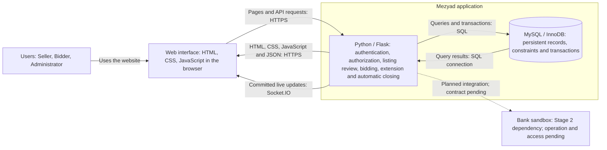
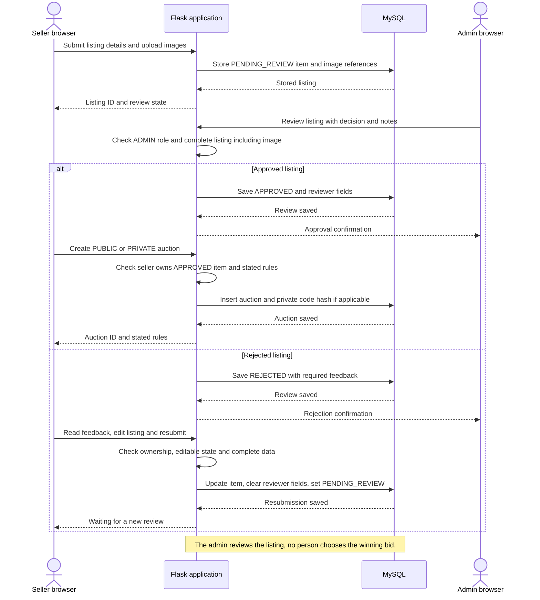
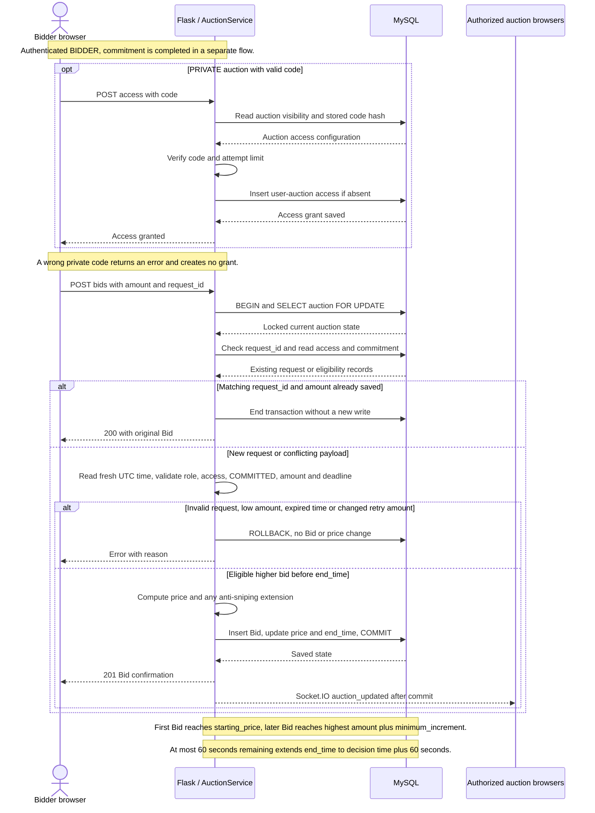
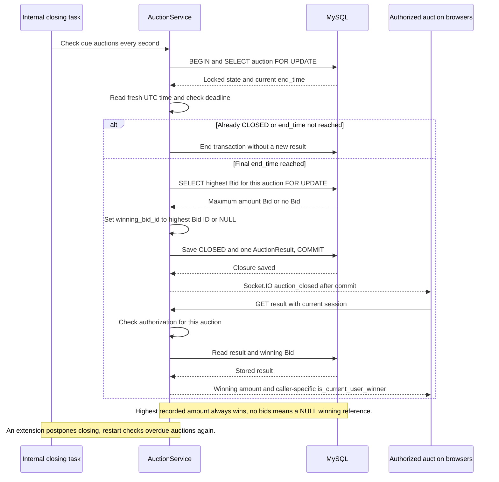

# Mezyad — Stage 3: Technical Documentation

**Project:** Mezyad — High-Value Asset Auction Platform  
**Team:** Abeer Al-Saiari, Ghadi Al-Zahrani, Aseel Al-Zahrani, Tala Al-Hudaibi  
**Level:** Holberton Novice — four team members  
**Version:** 10 October 2026 — revised technical proposal for team review

## Purpose and MVP Baseline

This document translates the Mezyad Project Charter into a plan for implementation. It covers user stories, mockups, architecture, components and classes, database relationships, sequences, API contracts, source control, testing, deployment, and technical justifications. It incorporates the team's requirements and the mentor feedback summary supplied by Ghadi. The application has not been implemented or tested in this repository.

[Stage 1](../Stage_1/Report.MD) records the research and selection of Mezyad. [Stage 2](../Stage_2/Report.MD) is the scope, objectives, responsibilities, and schedule baseline for Stage 3. Both documents remain unchanged. Earlier Stage 3 versions remain available in Git history.

The workflow remains:

Registration / Login → Seller Listing and Asset Information → Administrator Review → Public or Private Auction → Bid Commitment with a Saudi Open Banking Sandbox Interaction → Live Bidding and Anti-Sniping → Automatic Closure → Highest-Bid Winner and Auction Result

The sandbox interaction supports Bid Commitment; it is not a separate business stage. The MVP ends at the auction result. Payments, escrow, settlement, invoices, handover, delivery, and paid bidding attempts are outside the Stage 2 scope. The existing UI covers vehicles, real estate, camels, and vehicle plates. The same categories must appear in the interface, API, and test data.

### Deliverable Mapping

| Stage 3 task | Document section |
|---|---|
| Task 0 — User Stories and Mockups | Section 1: priorities, acceptance criteria, and screen mapping |
| Task 1 — System Architecture | Section 2: responsibilities, technologies, data flow, and architecture diagram |
| Task 2 — Components, Classes, and Database | Sections 3–4: classes, UI components, ERD, and SQL schema |
| Task 3 — High-Level Sequence Diagrams | Section 5: three critical interactions |
| Task 4 — External and Internal APIs | Section 6: methods, paths, input/output, events, and external dependency status |
| Task 5 — SCM and QA | Sections 7–8: Git, Docker, deployment, testing, and Manual QA |
| Task 6 — Complete Technical Documentation | Sections 9–10: justifications and delivery status |

There are exactly five technical diagrams: one architecture diagram, one ERD, and three sequence diagrams. They are Mermaid source blocks in this report. Classes, Docker, SCM, and QA are documented through tables and text. Figma remains the UI mockup reference.

### Continuity with Stage 2

| Stage 2 requirement | Stage 3 implementation plan | Verification |
|---|---|---|
| Registration, login, and three roles | User model, auth routes, server authorization | Authentication and role tests |
| Listings, category-specific information, and images | Item, Category, ItemImage, and ListingForm | Complete data and image checks |
| Admin review before publication | Review API and Sequence 1 | Only approved items proceed; QA11 |
| Public auction discovery | PUBLIC visibility, AuctionList, GET auctions | Private records excluded from public results |
| Private access through a seller-provided code | PrivateAuctionAccess, access API, Sequence 2 | Code validation and privacy tests; QA10 |
| Bid Commitment before bidding | BidCommitment and separate commitment route | COMMITTED checked for public and private auctions |
| Required Saudi Open Banking sandbox integration | Bank adapter and pending external contract | Actual sandbox test after access and operation selection |
| Live bidding, history, and timer | POST bids, Socket.IO updates, GET snapshot | QA01–QA05, QA14, and two-browser testing |
| Anti-sniping | End-time extension within the bid transaction | QA06–QA07 |
| Closure, winner, and result | AuctionService, AuctionResult, Sequence 3 | Highest recorded amount wins; QA08–QA09 |
| Six Smart Auction Assistant functions | Rules and queries with six API contracts | US10 and assistant tests; required for full MVP |
| Admin auction-status monitoring | AuctionMonitoringPanel and admin auction list | ADMIN-only read access; no manual winner selection |
| Shared Docker environment and team review | Compose, task branches, pull requests, and QA | Restart test and peer review |

The SMART objectives remain unchanged: the auction core works with at least two users by Week 9; the complete public and private workflow, including commitment, bank integration, and the assistant, works by Week 10 without manual database changes during the demonstration; testing results are recorded by Week 12. A seeded commitment fixture can test bidding, but does not satisfy the end-to-end sandbox objective.

The technical changes from the previous Stage 3 proposal are Flask instead of Express, MySQL instead of PostgreSQL, a database transaction and auction-row lock instead of Redis coordination, and Mermaid diagrams in the repository. These change implementation choices while retaining the Charter's product scope. A 60-second extension, one role per account, and one auction per item are explicit MVP design proposals for review, not requirements attributed to Stage 2.

## 1. User Stories and Mockups — Task 0

### Prioritized User Stories

| ID | MoSCoW | User story |
|---|---|---|
| US01 | Must | As a user, I want to register and sign in securely, so that I can use the functions allowed for my role. |
| US02 | Must | As a seller, I want to submit structured asset information and images, so that an administrator can review my listing. |
| US03 | Must | As a seller, I want to revise and resubmit a returned listing, so that I can correct its information. |
| US04 | Must | As an administrator, I want to approve or reject a listing with feedback, so that published assets have clear information. |
| US05 | Must | As a seller, I want to create a public or private auction with stated rules, so that authorized bidders can compete fairly. |
| US06 | Must | As a bidder, I want to enter a private access code, so that I can access a private auction. |
| US07 | Must | As a bidder, I want to place higher bids and see live price and time updates on one page, so that I can follow the auction. |
| US08 | Must | As a bidder, I want valid late bids to extend the stated deadline, so that participants have time to respond. |
| US09 | Must | As a participant, I want the highest recorded bid to win automatically at the final deadline, so that the result follows the auction rules. |
| US10 | Must | As a seller or bidder, I want the six assistant functions, so that I can prepare listings and find and follow auctions. |
| US11 | Could | As a bidder, I want additional public search filters, so that I can narrow results beyond the required basic search. |
| US12 | Must | As a bidder, I want to complete Bid Commitment through the bank sandbox before public or private bidding, so that I follow the required participation flow. |
| US13 | Must | As a bidder, I want to browse public auctions, so that I can find assets to bid on. |
| US14 | Must | As an administrator, I want to view auction statuses, so that I can monitor the auction workflow. |
| US15 | Should | As a user, I want invalid fields highlighted beside their validation messages, so that I can correct input more easily. |
| — | Won't | Online payments, escrow, invoices, delivery, paid bidding attempts, distributed infrastructure, and external generative AI are outside this MVP. |

Every Charter feature is Must, including all six assistant functions and the bank integration. Implementing these after the auction core follows the Stage 2 schedule; it does not make them optional. Should and Could describe improvements after the required workflow.

### Acceptance Criteria

| Story | Acceptance criteria |
|---|---|
| US01 | Register SELLER or BIDDER with a unique email; public registration cannot create ADMIN; responses exclude password hashes. |
| US02 | The server assigns the current seller; complete category fields and at least one image are required before admin review. |
| US03 | The owner sees rejection feedback, edits the listing, and resubmits; review fields are cleared and status returns to PENDING_REVIEW. |
| US04 | Only ADMIN reviews a PENDING_REVIEW listing; rejection requires notes; an invalid state returns 409. |
| US05 | Only the owner publishes an APPROVED item with valid price and timing rules; PRIVATE auctions are excluded from public discovery. |
| US06 | A correct code grants that user access to that auction; a wrong code creates no grant; code access does not complete commitment. |
| US07 | The first bid reaches the starting price; later bids reach the next minimum; a matching retry creates no second bid; two browsers show saved state. |
| US08 | A valid bid in the final 60 seconds sets the end time to the server decision time plus 60 seconds; both browsers receive the new time. |
| US09 | The server closes at the current final deadline, stores one result, and selects the highest bid; no bids means no winner. |
| US10 | All six functions use existing information, never recommend bid amounts or choose winners, and respect private-auction access. |
| US11 | Additional filters may follow the required public-search function without blocking the core MVP. |
| US12 | Public and private bids require COMMITTED; an unconfigured bank cannot create a false success; actual sandbox success is documented. |
| US13 | Public cards show asset, price, and time; private assets and images are not included in public search results. |
| US14 | ADMIN can view status, timing, and results; other roles cannot access the admin list; no winner-selection action exists. |
| US15 | The UI highlights invalid fields alongside the basic error message; this enhancement follows the required functionality. |

### Mockups and Screen Mapping

The existing interface is Arabic and right-to-left. Documentation is in English. The mockup references are [Figma UI Prototype](https://www.figma.com/proto/mbc0Qc5e0hR8dIaqQjbMMN/Mezyad-1?node-id=2-2&starting-point-node-id=2%3A2) and [Figma Make Prototype](https://www.figma.com/make/kPPjEPSCp5baGlCi8Lz2o4/Mezyad-1?t=Z7jnPTxHHkYSNbgS-20&fullscreen=1). These are the existing links documented in the original report; this revision does not claim to have edited them.

| Main screen | Components and interactions | Stories |
|---|---|---|
| Registration and login | AuthenticationForm, validation messages, role-based navigation | US01 |
| Public auction list | AuctionList, asset cards, price, time, category, and search | US05/US11/US13 |
| Listing creation or revision | ListingForm, category fields, images, feedback, AssistantPanel | US02/US03/US10 |
| Admin listing review | ReviewPanel, asset information, images, approve/reject and notes | US04 |
| Admin auction monitoring | AuctionMonitoringPanel, status and deadline, links to details/results | US14 |
| Auction setup | Starting price, increment, start/end times, visibility, and private code | US05 |
| Single auction page | Details, private access, commitment, bid form/history, timer, assistant, and result | US06–US10/US12 |
| Result within auction page | Won/lost/no-bids state; bidding controls disabled after closure | US09 |

The original prototype documents seven scenarios: Browse/Bid/Win, Outbid/Did Not Win, Submit/Approve/Publish, Listing Returned for Revision, Create/Join Private Auction, Using the Assistant, and Closed Without Bids. Keep these scenarios when reviewing the screens. If any screen suggests manual winner selection, revise it to show the automatic highest-bid result. A technical ERD does not replace screen mockups.

### Shared Business Rules

1. The account role is BIDDER, SELLER, or ADMIN. One role per account is the proposed simplification; public registration cannot create ADMIN.
2. Listings move from PENDING_REVIEW to APPROVED or REJECTED. Creating the record and uploading images are separate requests; incomplete records do not enter the admin review list.
3. The seller may edit a pending or rejected listing. Resubmission clears reviewer fields and returns it to PENDING_REVIEW. Approved or published asset information cannot change behind bidders.
4. Only the seller who owns an APPROVED item creates its auction. The proposed MVP allows zero or one auction per item; re-auctioning the same item is deferred. This is enforced by UNIQUE(item_id).
5. A PRIVATE auction uses a hashed access code. The seller shares the link and code outside the platform, as specified in Stage 2. Validating the code creates a user–auction access grant.
6. Private authorization covers the auction, item, images, assistant data, and live-update room. The owner and ADMIN retain access for their work.
7. Bid Commitment is required for both public and private bidding and is separate from a private grant. It is a participation checkpoint, not proof of funds or guaranteed seriousness; the actual bank operation remains unresolved.
8. The first bid must be at least starting_price. Every later bid must be at least the highest recorded amount plus minimum_increment. Equal recorded amounts are not accepted.
9. A valid bid accepted before the deadline with at most 60 seconds remaining sets end_time to decision time plus 60 seconds. Repeated qualifying bids repeat this extension.
10. Server UTC time is authoritative. A browser countdown is only a display. At the final deadline the highest recorded bid always wins automatically; no person approves or chooses a winning bid.
11. A closed auction with no bids stores a result with winning_bid_id=NULL. Bids and results cannot be edited or deleted through the MVP API.
12. Listings must present truthful information and clear rules. The seller cannot bid on the asset they are selling. Do not implement fake bids, paid attempts, or automatic artificial price increases.

## 2. System Architecture — Task 1

### Architecture Approach

Mezyad uses one Flask web application and one MySQL database. Presentation, business rules, and data access are separate responsibilities inside the same application. This is a layered monolith, suitable for a four-person team that already knows Python, Flask, MySQL, HTML, CSS, and JavaScript. It does not require Redis or independent microservices.

The browser renders HTML/CSS/JavaScript and sends HTTPS requests to Flask. Flask authenticates the session, checks permissions and business rules, and queries or updates MySQL. The database is never accessed directly by the browser. SQLAlchemy maps Python model classes to the relational tables.

Flask serves Jinja pages and JSON APIs. Bid submission uses POST; Flask-SocketIO publishes live price, time, and closure updates after a successful database commit. A GET snapshot recovers state after a connection interruption. The server owns price, timing, and winner decisions.

The diagram follows standard architectural practices: named responsibilities, technology labels, and annotated communication arrows. Docker and GitHub belong to the development/deployment plan and do not sit between a user request and the application.

### Architecture Diagram



The dotted bank connection represents a required external dependency whose operation and access are pending. It does not claim a working banking integration.

### Runtime Boundaries

The proposed Docker application runs as one process with one threaded Gunicorn worker and simple-websocket support for Flask-SocketIO. It has one internal auction timing task. Separate requests and background threads use separate SQLAlchemy sessions. The Flask development server is not the production deployment plan.

This is a limited student deployment. Adding workers or application replicas requires revisiting live-event delivery and the single timing-task assumption. The project does not claim distributed scalability. Live events supplement stored records; they are not durable business state.

The Smart Auction Assistant remains six lightweight functions implemented through rules and queries. It is not a chatbot, price-prediction model, or external AI integration.

## 3. Components and Classes — Task 2

### Backend Classes

| Class / table | Key attributes | Methods or responsibility |
|---|---|---|
| User / users | id, name, email, password_hash, role | set_password(), check_password() |
| Category / categories | id, code, name | Defines the supported asset category; no artificial business methods |
| Item / items | seller_id, category_id, title, description, category_fields, status, reviewed_by | can_edit(), resubmit(); ownership is checked by the route/service |
| ItemImage / item_images | id, item_id, image_path, display_order | Image upload and validation handled by a route/helper |
| Auction / auctions | item_id, visibility, status, prices, increment, start_time, end_time | is_open(now), minimum_next_amount(); final decisions use locked current state |
| PrivateAuctionAccess / private_auction_access | auction_id, user_id, granted_at | One user–auction grant; no separate business method needed |
| BidCommitment / bid_commitments | auction_id, bidder_id, status | is_committed() |
| Bid / bids | id, auction_id, bidder_id, amount, request_id, created_at | Immutable accepted bid record |
| AuctionResult / auction_results | auction_id, winning_bid_id, closed_at | Immutable result; no choose_winner() method |
| AuctionService / no table | db_session | ensure_access(), place_bid(), close_if_due() |

The nine model classes match the nine tables. Roles are values in User, not Seller/Bidder/Admin subclasses. AuctionService depends on the models and coordinates transactions; it does not own a separate database table. The complete attributes and SQL types are in [schema.sql](schema.sql).

### File Organization

This is a Stage 4 implementation plan, not a claim that these application files already exist.

| Planned location | Responsibility |
|---|---|
| `app/__init__.py` | Create Flask application and initialize configuration, SQLAlchemy, and Socket.IO |
| `app/models.py` | Nine persistent model classes matching the SQL schema |
| `app/routes/auth.py` | Registration, login, logout, current user |
| `app/routes/items.py` | Seller listings, images, admin review, resubmission |
| `app/routes/auctions.py` | Discovery, details, private access, commitment, bids, results, monitoring |
| `app/auction_service.py` | The single implementation of bid, extension, and closing transaction rules |
| `app/assistant.py` | Six rule/query-based helper functions |
| `app/bank_adapter.py` | Provider-specific sandbox call after its actual contract is selected |
| `app/closing_task.py` | One timing task, including recovery of overdue auctions after restart |
| `app/templates/` and `app/static/` | Jinja/HTML, CSS, JavaScript, and live state presentation |
| `migrations/` and `tests/` | Reviewed schema changes and business/integration tests |

### Frontend Components

These are HTML/JavaScript UI sections, not a requirement to use React.

| Component | Interaction |
|---|---|
| AuthenticationForm | POST register/login, GET current user, show validation, then navigate |
| ListingForm | Create/update item, upload images, show feedback, and resubmit |
| ReviewPanel | Read complete submitted items; ADMIN sends approve/reject decision |
| AuctionMonitoringPanel | ADMIN reads auction statuses and opens details/results without choosing winners |
| AuctionList | GET public discovery results and render asset, price, and deadline |
| AuctionDetails | GET authorized snapshot; render information and server time |
| PrivateAccessForm | POST code; successful access is separate from commitment |
| CommitmentPanel | Complete the required commitment flow before enabling bids |
| BidForm and BidHistory | POST amount/request_id; render saved state or a clear error |
| AuctionResultPanel | On closure, GET the caller-specific result and disable bidding |
| AssistantPanel | Call one of the six functions and display an editable suggestion or summary |

Price, timer, bid form, history, assistant, and result stay on the same auction page. The UI does not increase the displayed authoritative price before confirmation. After an interruption it reloads the snapshot from the server.

## 4. Database Design — Task 2

### Schema and Table Responsibilities

The relational schema targets MySQL 8.4 with InnoDB and utf8mb4. [schema.sql](schema.sql) contains all columns, types, nullability, foreign keys, CHECK constraints, and unique keys. It is a proposal and has not been executed against MySQL in this work.

| Table | Purpose |
|---|---|
| users | Account, role, and password hash |
| categories | Vehicles, real estate, camels, and plates |
| items | Asset, seller, category, descriptive fields, review state, and latest review feedback |
| item_images | One image path and display order per row; multiple images per item |
| auctions | Visibility, timing, bid rules, and current price; seller comes from Item |
| private_auction_access | One private access grant per user and auction |
| bid_commitments | One commitment state per bidder and auction |
| bids | Each accepted amount, bidder, auction, time, and retry identifier |
| auction_results | One closing result referencing the winning bid or NULL |

A Flask signed-cookie session needs no user_sessions table in this design. Store user_id in the session and read the current role from users. Do not put bank data or private codes in the cookie.

### Relationship Cardinalities

| Relationship | Correct meaning and enforcement |
|---|---|
| User → Item as seller | An item has exactly one seller; a user has zero or many items. |
| User → Item as reviewer | An item has zero or one reviewer; a reviewer can review many items. reviewed_by is NULL before review. |
| Category → Item | Each item belongs to one category; a category has zero or many items. |
| Item → ItemImage | Each image belongs to one item. A record may start with no images; application validation requires an image before review. |
| Item → Auction | Each auction has one item; an item has zero or one auction under the proposed UNIQUE(item_id) limit. |
| User/Auction → PrivateAuctionAccess | Each grant links one user and one auction; the composite primary key prevents duplicate grants. Public access needs no grant. |
| User/Auction → BidCommitment | Each commitment links one bidder and one auction; the pair is unique, not one commitment per bid. |
| User/Auction → Bid | Each bid has one bidder and one auction; both can have zero or many bids. |
| BidCommitment → Bid | A composite foreign key requires the commitment for the same bidder and auction; the server separately checks COMMITTED. |
| Auction → AuctionResult | Zero or one result during the lifecycle; PRIMARY KEY(auction_id) prevents two results. The closing service creates one. |
| Bid → AuctionResult | A result has zero or one winning bid; a bid wins zero or one result. The composite FK rejects a bid from another auction. |

In the ERD, `||` means exactly one, `o|`/`|o` means zero or one, and `o{` means zero or many. Solid identifying relationships include the parent's identity in the child's primary key; dotted relationships do not. These are data relationships, not network messages.

### Database ER Diagram


### Data Dictionary and Integrity Rules

| Data | Type and rule |
|---|---|
| IDs and references | INT UNSIGNED; matching FK types; AUTO_INCREMENT except linking tables and result |
| User fields | VARCHAR(120) name, VARCHAR(254) unique email, VARCHAR(255) password hash; normalize email to lowercase |
| Item content | VARCHAR(200) title, TEXT description, VARCHAR(150) optional location; location required for real estate by application validation |
| Money | DECIMAL(18,2), positive, SAR only; Python Decimal and decimal strings with at most two places in JSON |
| Times | DATETIME(6) stored as UTC; API uses ISO 8601 with Z; end_time > start_time |
| Review state | PENDING_REVIEW, APPROVED, REJECTED; reviewed_by/reviewed_at together after review; rejection notes required |
| Auction state | SCHEDULED, ACTIVE, CLOSED; server time and eligibility checks still required |
| Images | Server-generated file path; UNIQUE(item_id,display_order); access checked through the image route |
| Private code | Hash present only for PRIVATE; NULL for PUBLIC; never returned through the API |
| Retry identifier | UUID string; UNIQUE(auction_id,bidder_id,request_id) |
| Current price | NULL before the first bid, then maintained with the Bid within the same transaction |
| Winning reference | NULL only for a closed auction with no bids; otherwise a winning Bid from that auction |
| Deletion | Foreign keys use RESTRICT; no Bid or AuctionResult delete/update API |

UNIQUE(auction_id,amount) prevents recorded ties but does not enforce the minimum increment. The server validates it while holding the auction-row lock. Reusing a request_id with the same amount returns the original bid; changing the amount with that key gives a conflict.

The result stores auction_id and winning_bid_id, not repeated winner_id and winning_amount. Those values are derived from Bid/User. The FK on (auction_id,winning_bid_id) prevents choosing a bid from a different auction. It does not prove that the bid is highest; the closing transaction must enforce that rule.

current_price is an intentional derived value for display. It is updated with the accepted bid in the same transaction and tested against the maximum recorded amount. The browser cannot supply it. A foreign key proves existence, not that a user is a seller/admin or that a commitment is COMMITTED; those conditions require server checks.

### Category-Specific Asset Fields

category_fields is a small JSON object containing descriptive asset properties only. Relationships, owner, bids, prices, and results remain relational columns. This avoids a large category taxonomy for four simple categories; complex category-specific search would require reassessing the design.

Vehicle and property fields come from Stage 2. Camel and plate fields below are simple proposals to review against the existing screens, not invented claims about the current prototype.

| Category code | Required category_fields | Optional fields and validation |
|---|---|---|
| vehicles | make, model, year, mileage, condition | Logical integer model year; nonnegative integer mileage; nonempty condition |
| real_estate | propertyType, area, bedrooms, condition | Positive decimal-string area in square metres; nonnegative integer bedrooms; location stored once in items |
| camels | breed, sex, age_months | Optional name and health_notes; sex=MALE/FEMALE; nonnegative integer age; seller description is not medical verification |
| plates | plate_text | Optional plate_type; nonempty plate identifier; e.g. NJD 1 in documentation |

Reject unknown category keys. Do not repeat the property's location in JSON. Asset descriptions may be Arabic in the application; the technical document and code identifiers remain English.

## 5. High-Level Sequence Diagrams — Task 3

### Critical Use Cases

1. Submit an item, review it, and publish an approved public/private auction. Rejection leads to feedback, revision, and resubmission.
2. Validate private access, then accept an eligible bid with a completed commitment. Public bidding skips the private-code step only. Bank commitment is a separate flow, not a call inside the bid lock.
3. Automatically close at the current final deadline and store the highest bid or a no-bids result. An extension postpones closure.

### Transaction and Timing Rules

The single internal task checks auctions every second, opens SCHEDULED auctions at start_time, and closes due auctions at the current end_time. It works without an open browser and checks overdue auctions again after restart. If both times have passed, it closes the auction directly. Avoid starting the task twice through the development reloader.

GET and POST paths also check current time and use close_if_due where needed; an ACTIVE status alone does not permit a bid after the deadline.

place_bid authenticates the user, begins a transaction, locks the Auction row, checks for a matching retry, reads fresh UTC time after obtaining the lock, validates role/access/COMMITTED/amount/deadline, inserts Bid and updates price/end time, commits, then emits an event. close_if_due locks the same row. This coordinates bidding, extension, and closing.

Refresh any previously loaded SQLAlchemy auction state when reading the locked row. Read duplicate requests and the highest Bid using current locking reads, so a MySQL snapshot from before the lock cannot decide the result. Use one SQLAlchemy session per request/thread; the timing task must not share a browser request's session. These rules need actual concurrency tests, not only a diagram labelled transaction.

### Sequence 1 — Listing Review and Publication



### Sequence 2 — Private Access and Bidding



### Sequence 3 — Automatic Closing



## 6. External and Internal APIs — Task 4

### Shared API Conventions

The base path is `/api/v1`. POST/PATCH use application/json except multipart image upload. Empty request bodies use `{}`. IDs are positive integers, amounts are decimal strings, and timestamps are UTC ISO 8601. A 204 response has no JSON body.

Server-managed fields such as id, seller_id, bidder_id, reviewed_by, status, current_price, and winning_bid_id cannot be set by a browser. Identity comes from the authenticated session. Fields such as review decision and auction visibility are allowed only through their documented actions.

Use a signed session cookie with HttpOnly, Secure on HTTPS, and SameSite=Lax. Send a Jinja-provided CSRF token in X-CSRFToken for state-changing requests. Keep session secrets, credentials, and tokens outside Git. Password and access-code hashes never appear in responses.

Lists use page >=1 and page_size between 1 and 50, default 20. q is at most 200 characters. Apply access restrictions before counts and summaries. Images accept JPEG/PNG with a proposed 5 MB limit; validate content/type, generate a server filename, and store outside publicly served static files.

### Common Response Shapes

The notation below defines JSON objects, not additional tables. Return only data permitted for the current session.

| Shape | Fields |
|---|---|
| User | id:number, name:string, role:string; email only for the account itself |
| Category | id:number, code:string, name:string |
| Image | id:number, item_id:number, url:string pointing to the authorized image route, display_order:number |
| Item | id, seller_id, category_id, title, description, location:null/string, category_fields:object, status, images:Image[]; review_notes only for owner/ADMIN |
| Auction | id, item_id, visibility, status, starting_price:string, current_price:null/string, minimum_increment:string, anti_sniping_seconds:60, start_time, end_time |
| Bid | id, auction_id, amount:string, created_at; request_id only for its sender; no competitors' private account data |
| Snapshot | auction:Auction, item:Item, bids:Bid[], server_time:string, access_granted:boolean, commitment_status:null/string |
| Result | status:CLOSED, winning_bid_id:null/number, winning_amount:null/string, closed_at:string, is_current_user_winner:boolean |

List wrappers are `{ "auctions": [], "page": 1, "page_size": 20, "total": 0 }` or the corresponding items wrapper. User/item/image/auction operations return `{ "user": User }`, `{ "item": Item }`, `{ "image": Image }`, or `{ "auction": Auction }` as specified below. These capitalized names describe the shapes; they are not literal JSON values.

### Internal Endpoints

All protected routes require a session. Unauthorized role access returns 403, while a missing session returns 401.

| Method and path | Input | Success output and authorization |
|---|---|---|
| POST /api/v1/auth/register | name, email, password, role=SELLER/BIDDER | 201 user wrapper; cannot register ADMIN |
| POST /api/v1/auth/login | email, password | 200 user wrapper and session cookie |
| POST /api/v1/auth/logout | {} | 204; clear session |
| GET /api/v1/auth/me | None | 200 user wrapper for current account |
| GET /api/v1/categories | None | 200 categories[] wrapper |
| POST /api/v1/items | category_id, title, description, location, category_fields | 201 item wrapper; SELLER; upload images before review |
| GET /api/v1/items/mine | page/page_size optional | 200 items wrapper, including auction summary if present; current SELLER only |
| GET /api/v1/items/{id} | Item ID | 200 item wrapper; owner/ADMIN or through an authorized auction |
| PATCH /api/v1/items/{id} | Allowed changed content fields | 200 item wrapper; owner, PENDING_REVIEW/REJECTED, before approval |
| POST /api/v1/items/{id}/images | multipart file | 201 image wrapper; owner before approval/publication |
| GET /api/v1/item-images/{id} | Image ID | 200 image bytes after item/auction access check |
| POST /api/v1/items/{id}/resubmit | {} | 200 item wrapper in PENDING_REVIEW after complete fields/image checks |
| GET /api/v1/admin/items | status, page, page_size optional | 200 items wrapper; ADMIN; incomplete records excluded from review queue |
| POST /api/v1/items/{id}/review | decision=APPROVED/REJECTED, notes | 200 item wrapper; ADMIN; notes required for rejection |
| POST /api/v1/auctions | item_id, visibility, starting_price, minimum_increment, start_time, end_time; access_code for PRIVATE | 201 auction wrapper; owner of APPROVED item |
| GET /api/v1/auctions | category_id, q, page, page_size optional | 200 public auctions wrapper; authenticated discovery |
| GET /api/v1/admin/auctions | status, page, page_size optional | 200 auctions wrapper; ADMIN monitoring of all auction statuses |
| GET /api/v1/auctions/{id} | Auction ID | 200 Snapshot; private access checked |
| POST /api/v1/auctions/{id}/access | code | 200 {"access_granted":true}; BIDDER; validate code and attempt limit |
| POST /api/v1/auctions/{id}/commitment | Pending actual bank operation | Contract not final; expected commitment.status after verified sandbox flow |
| POST /api/v1/auctions/{id}/bids | amount:string, request_id:UUID | 201 bid/auction wrapper; 200 for matching retry; BIDDER with access and COMMITTED |
| GET /api/v1/auctions/{id}/result | Auction ID | 200 Result for authorized session; 409 before closure |

status filters accept only their documented item/auction states. Conflicting email, a second auction for the same item, an invalid review state, low bid, or changed retry payload returns 409. The admin monitoring endpoint is read-only and does not override timing or the winner.

### Request and Response Examples

Create an item:

```json
{
  "category_id": 1,
  "title": "2020 vehicle",
  "description": "Accurate condition and available asset information.",
  "location": "Riyadh",
  "category_fields": {
    "make": "Example",
    "model": "Example",
    "year": 2020,
    "mileage": 30000,
    "condition": "used"
  }
}
```

The server assigns the seller and PENDING_REVIEW state. Upload the image after creating Item; the review queue checks completeness. Approve with `{ "decision": "APPROVED", "notes": "" }`, or reject with `{ "decision": "REJECTED", "notes": "Explain the missing information." }`.

Stage 2 includes price and times among seller inputs. They are stored on Auction and entered in auction setup after approval, as in the existing prototype. This separates asset information from auction rules without removing those seller inputs.

Create a private auction:

```json
{
  "item_id": 12,
  "visibility": "PRIVATE",
  "starting_price": "1000.00",
  "minimum_increment": "50.00",
  "start_time": "2026-10-11T12:00:00Z",
  "end_time": "2026-10-11T12:30:00Z",
  "access_code": "example-private-code"
}
```

The sample code is not an active credential. A PRIVATE code is 8–64 characters and is stored as a hash; PUBLIC requests omit it. A future start produces SCHEDULED. Invalid timing gives 400. A proposed per-user/per-auction limit allows five failed code attempts in five minutes; further attempts give 429. In this single-process MVP the in-memory attempt counter resets on restart; record that limitation.

Submit a bid:

```json
{ "amount": "1500.00", "request_id": "6a550a11-14e0-4fa2-9806-e8a5d7fbfc23" }
```

Example success (the full response follows the Bid and Auction shapes):

```json
{
  "bid": { "id": 42, "auction_id": 7, "amount": "1500.00", "created_at": "2026-10-11T12:29:00Z" },
  "auction": { "id": 7, "current_price": "1500.00", "end_time": "2026-10-11T12:30:00Z", "status": "ACTIVE" }
}
```

No-bids closing result:

```json
{
  "status": "CLOSED",
  "winning_bid_id": null,
  "winning_amount": null,
  "closed_at": "2026-10-11T12:30:00Z",
  "is_current_user_winner": false
}
```

Errors use `{ "error": { "code": "BID_TOO_LOW", "message": "The bid must reach the next minimum amount." } }`. Relevant statuses are 400 invalid input, 401 unauthenticated, 403 forbidden, 404 missing record, 409 conflicting state/amount/retry, 413 oversized image, 415 unsupported type, 429 attempt limit, and 503 unconfigured bank dependency.

### Live Event Contracts

| Event | Payload and behavior |
|---|---|
| join_auction, client → server | {auction_id}; validate session and authorization before joining; return authorized Snapshot |
| auction_updated, server → room | {auction_id,current_price,end_time,status}; emitted only after commit |
| auction_closed, server → room | {auction_id,status}; emitted after stored closure; each client fetches its own result |

Bid writes use POST, not a second Socket.IO bid-writing path. Do not broadcast is_current_user_winner to the whole room, because it is specific to the caller. Reload a snapshot after reconnecting; a missed event cannot change the stored winner.

### Six Smart Auction Assistant APIs

| Method and path | Input | JSON output and access |
|---|---|---|
| POST /api/v1/assistant/title | category_id, category_fields | {"title":"Suggested title"}; SELLER |
| POST /api/v1/assistant/missing-fields | category_id, title, description, location, category_fields, image_count | {"missing_fields":["description","images"]}; SELLER; drafts allowed |
| GET /api/v1/assistant/search | q, category_id, location, min_price, max_price, page, page_size optional | Public auctions wrapper only; authenticated user |
| GET /api/v1/auctions/{id}/assistant/activity-summary | Auction ID | {"bid_count":5,"bidder_count":3}; authorized auction access |
| GET /api/v1/auctions/{id}/assistant/bid-timeline | Auction ID | {"timeline":[{"minute_start":"2026-10-11T12:01:00Z","bid_count":2}]}; authorized access |
| GET /api/v1/auctions/{id}/assistant/auction-summary | Auction ID | {"status":"ACTIVE","current_price":"1500.00","bid_count":5,"remaining_seconds":45,"server_time":"2026-10-11T12:29:15Z"}; authorized access |

All values come from existing data or the seller's draft. There is no pricing prediction, valuation, recommended bid, automatic bid, winner prediction, financial decision, or admin replacement. With no bids, counts are zero, timeline is empty, and current_price is NULL. Price filters use current_price if present, otherwise starting_price. For a saved item, use the server's image count; a draft image_count is a suggestion input only and cannot pass actual listing validation.

### External API and Bank Dependency

| Dependency | Purpose and choice | Actual status |
|---|---|---|
| Saudi Open Banking sandbox: SABB primary candidate, Al Rajhi backup | Required Stage 2 supporting integration inside Bid Commitment, using test data only | Ghadi confirmed on 10 October that access and a specific operation are not available |
| Figma | Existing UI design/reference | Design tool, not called during auction runtime |
| GitHub and Docker | Source control/review and reproducible execution | Development tools, not financial APIs or winner selectors |

The bank's actual method/path, authentication, required permissions, request, response, timeout/errors, and condition for COMMITTED cannot be finalized until the team selects a documented supported operation and obtains access. Do not invent a provider endpoint, consent field, reference field, or financial eligibility claim.

Until configured, POST commitment returns 503 BANK_SANDBOX_NOT_CONFIGURED and does not create COMMITTED. A COMMITTED fixture in a test database may exercise bidding tests, but is not evidence of bank integration and does not satisfy the Week 10 objective. After selecting the operation, a timeout/failure must not permit bidding. Do not call the bank while holding the bid transaction lock.

This is a sandbox integration only: no production banking data, payment, deposit, escrow, or money transfer. Reading a test account does not by itself prove funds or seriousness. If the required operation is unavailable, record a scope decision with the mentor and update the approved documents together; this revision does not silently remove the requirement.

## 7. SCM, Docker, and Deployment — Task 5

### Source Control Process

Use Git and GitHub. Each member creates a branch for a task, pushes commits, opens a pull request, and has another member review it before merging.

development → task branch → small commits → local Docker/testing → push → PR to development → peer review → merge → integration checks → release PR to main → staging → production

| Branch | Purpose |
|---|---|
| main | Reviewed release version |
| development | Integration of completed tasks |
| `feature/<member>-<task>` or `fix/<task>` | One focused task or correction; merged through a PR |

Example task branches are feature/ghadi-auction-page, feature/aseel-auth, feature/tala-bidding, and feature/abeer-data-model. They illustrate naming, not a replacement for the Stage 2 responsibility assignments. A member may create multiple task branches; a branch is not a permanent private copy of all their work.

1. Update local development and create the task branch.
2. Implement and update affected API/documentation; verify locally with Docker.
3. Commit with a clear action, such as `Add private auction access validation`, then push the branch.
4. Open a PR to development describing the problem, change, and validation.
5. Another member reviews logic, permissions, schema/API agreement, and tests.
6. Resolve review comments and conflicts in the task branch; rerun affected checks, then merge.
7. Review a release PR to main and deploy the same version first to staging.

Do not force-push main/development. Track implementation tasks as small GitHub Issues with an owner and acceptance criteria. The initial private test-repository copy and documentation upload are setup commits, not evidence that this future implementation workflow is already configured.

### Existing Team Responsibilities

These remain the primary areas defined in Stage 2, with cross-review and flexibility.

| Area | Members |
|---|---|
| Database | Abeer and Tala |
| Backend | Abeer and Ghadi |
| Frontend | Aseel and Ghadi |
| Figma/UI/UX | Ghadi |
| Task review and cross-task integration | Tala and Aseel |
| Task allocation, technical approach, and Docker operation | Abeer and Ghadi |

### Docker Compose Plan

Docker keeps the four members' development environments consistent. It does not manage branches, merge code, or decide auction outcomes.

| Service or configuration | Plan |
|---|---|
| app | Fixed Python image and tested/pinned requirements; Flask, SQLAlchemy, Flask-SocketIO; one threaded server worker |
| db | MySQL 8.4, InnoDB, utf8mb4; application database and limited application user |
| Compose network | app uses DB_HOST=db; localhost in app does not refer to the database container |
| db_data and uploads | Persistent volumes for records and images across restarts |
| Startup | Wait for database readiness, run documented migrations once, then create test data where appropriate |
| Configuration | .env.example lists variable names; real .env, secrets, uploaded images, and database files are excluded from Git |

Planned Stage 4 files are Dockerfile, compose.yaml, requirements.txt, .env.example, .gitignore, and migrations. They are not implemented or running in this documentation-only repository. The local start command will be `docker compose up --build`. The database port normally stays within the Compose network. Do not use down -v on an environment whose data must be preserved.

schema.sql proposes the initial structure; after implementation starts, use reviewed migrations for changes. Seeded users/assets support repeatable tests; do not seed production credentials or test commitments into production.

### Staging and Production

The deployment host and budget are not selected. Plan a manual, documented release on a host that supports Docker and HTTPS. GitHub stores/reviews code; GitHub Pages cannot run this Flask/MySQL application.

| Step | Planned action and success condition |
|---|---|
| Prepare version | Check out a known commit, build the application image, configure environment, and back up data before migration |
| Staging | Separate database, secrets, and volumes; apply migration; test login, listing review, public/private access, bids, extension, and closure |
| Release decision | Record smoke-test results and peer review; a staging failure blocks production |
| Production | Deploy the same application version with separate secrets/data and HTTPS; check health and core flow |
| Rollback | Restore previous image if schema is compatible; otherwise follow the migration/backup recovery plan |

Plan GET /health with no input: 200 {"status":"ok"} when the app/database are ready, and 503 when unavailable, without secrets. Test state-changing flows in staging; production smoke checks use read-only checks or a clearly designated demo auction. Do not claim a deployed pipeline or passing health check before implementation. GitHub Actions may be added after the team understands its tests; it is not required to build this MVP.

## 8. QA Strategy and Manual Review — Task 5

### Testing Strategy

| Type | Cases | Tools |
|---|---|---|
| Unit | First bid, increment, extension, highest amount, no-bids result, missing fields | pytest |
| Integration | FKs, cross-auction result rejection, roles/ownership, resubmission, commitment | pytest, Flask test client, separate MySQL test database |
| API | Inputs, outputs, response statuses, matching/conflicting retry IDs | Postman and Flask test client |
| Concurrency | Simultaneous bids, retry race, bid/extension/close race | Actual MySQL with independent connections and sessions |
| Manual UI | RTL, images, wrong code, two browsers, connection loss, win/loss/no bids | Different accounts and browser sessions |
| Privacy | Private item, image, assistant, and live-room access without a grant | API and browser tests |
| Restart | Overdue closure recovery and persistent records/images | Docker restart and manual checks |
| Bank integration | Actual selected operation success, failure, timeout, and commitment effect | Provider sandbox after access; mock alone is insufficient |

Feature tests run during implementation, not only in Weeks 11–12. Record commit, environment, steps, expected/actual result, tester, and pass/fail. Every test below starts Not Run; these are planned checks, not claimed results.

### Critical Acceptance Tests

| ID | Scenario | Expected result |
|---|---|---|
| QA01 | starting_price=1000; first bid 950, then 1000 | Reject 950; accept 1000 |
| QA02 | current=1000, increment=50; bid 1020, then 1050 | Reject 1020 without changing price; accept 1050 |
| QA03 | Two identical auction/bidder/request_id/amount requests | Store one Bid; matching retry returns 200 with that Bid |
| QA04 | Reuse request_id with a different amount | 409; no second bid |
| QA05 | Two bidders submit the same amount concurrently | Accept one only; reject the other against current price; no recorded tie |
| QA06 | Valid bid with 30 seconds remaining | end_time becomes server decision time +60 seconds; broadcast saved deadline |
| QA07 | Bid races with the closing task | Same row lock coordinates both; valid extension first postpones closure; closure first rejects a later bid |
| QA08 | Auction ends with bids | Exactly one result referencing the highest amount; CLOSED; no manual-winner route |
| QA09 | No-bids closure or restart after end_time | One result with NULL winner; repeat checks create no duplicate |
| QA10 | Wrong private code or unauthorized item/image/assistant/join request | No grant or private-data disclosure |
| QA11 | Another seller or bidder tries review/edit | 403; ADMIN reviews; owner edits only before approval |
| QA12 | Result references a bid belonging to another auction | Database rejects the composite FK |
| QA13 | Bank unconfigured or selected operation times out/fails | No COMMITTED and no bid permission; clear error without secrets |
| QA14 | Client loses connection around closure and reconnects | Snapshot/result reflect stored MySQL state |
| QA15 | Docker restart | Records/images persist; one timing task; overdue auctions recover |
| QA16 | Seller tries bidding or client supplies owner/price/winner fields | Reject prohibited action/input; no artificial price change |
| QA17 | Test all six assistant functions and admin monitoring | Required outputs exist, privacy holds, ADMIN-only monitoring, no decision-making assistant |

Mermaid rendering checks verify diagram syntax only. MySQL execution and concurrency tests must verify the actual schema and auction logic during Stage 4. A valid diagram cannot prove that a bid transaction is correctly implemented.

### Required Holberton Manual QA

The task requires a Manual QA review request when the Stage 3 deliverable is ready. After team review, resolve or formally document the bank dependency with the mentor and check mockup agreement. Submit the repository/report link, commit version, Figma references, ERD, and API documentation through Holberton's review process. This review has not been requested or completed by this work.

## 9. Technical Justifications and Mentor Feedback

### Decisions and Their Requirements

| Decision | Reason |
|---|---|
| Python and Flask | Known team technologies; clear routes/templates and one app that students can explain |
| HTML/CSS/JavaScript with Jinja | Responsive Arabic RTL screens and one auction page without adding an unfamiliar frontend framework |
| MySQL/InnoDB and SQLAlchemy | Relational ownership, FKs, unique constraints, transactions, and familiar Python classes |
| Three role values in User | Fixed roles and the proposed one-role account need no role hierarchy or artificial subclasses |
| Separate Item and Auction | Asset content/review differs from timing, price, and visibility; seller is derived from Item |
| Separate access and commitment | A private grant does not complete the required bidding checkpoint |
| Immutable Bid and one AuctionResult | Preserve bidding history and a deterministic highest-bid reference without duplicated winner/amount fields |
| One auction-row transaction lock | Coordinates bid validation, extension, and closure without Redis coordination |
| POST bids and Socket.IO updates | One write path, with live updates only after durable save and GET recovery |
| One internal timing task | Close without an open browser and recover after restart within the single-process deployment |
| Small category JSON object | Store only limited variable descriptions; keep ownership, bids, and results relational |
| Docker Compose | Shared app/database environment, service networking, and persistent volumes |
| Task branches and reviewed PRs | Each member submits reviewable work and another member understands it before integration |
| Mermaid and existing Figma mockups | Review technical diagram source in Git; retain screen/user-flow references |
| Six rules/query-based assistant functions | Preserve Stage 2 functionality without external AI cost, predictions, or automated bidding decisions |
| Workflow ends at result | Preserve Charter scope without adding financial settlement or delivery infrastructure |

### Team and Mentor Requirements

| Requirement or feedback | Result in this proposal |
|---|---|
| Highest amount always wins | Automatic closing selects the highest recorded Bid; no human winner selector |
| Preserve private auctions | PUBLIC/PRIVATE visibility, code hash, user–auction grant, and protected related data |
| Halal-oriented mechanisms | Truthful asset information, stated rules, no seller self-bidding, fake bids, paid attempts, or invented financial flows |
| Use tools the team understands | Flask/MySQL/HTML/CSS/JavaScript reflect team experience; each additional library needs a small working exercise |
| Avoid tool overload | One application and one database; remove Redis, distributed cache, and microservices from this MVP |
| Show who communicates with whom | Architecture arrows name HTTPS, SQL, and committed live updates; sequences show the actual save/close order |
| Correct relationships and class names | Nine model/table names agree across classes, ERD, SQL, and API concepts |
| Docker and member branches | Compose plan plus task branches, PR review, and integration process |
| Required diagrams only | Exactly five Mermaid diagrams; other plans use tables/text |
| Preserve stage continuity | Stage 2 controls product scope; changes simplify the technical implementation rather than replacing the project |
| English repository work and clear commits | Report, schema comments, and diagram labels use English; commits have clear English titles without an extended description |

These mechanisms support the team's stated requirements; they are not a formal religious approval of every contract detail. The team must understand why each tool is used, how a request travels, what is stored, and how a failure affects the workflow. Two members should be able to explain a new library before merging it.

The first learning exercise should demonstrate two browsers, two bids, an auction-row lock, a late extension, and the automatic highest-bid result. Build the other screens around that working core. Novice scope reduces tool count and deployment complexity; it does not remove the need for correct timing and concurrency.

## 10. Delivery Checklist — Task 6

| Item | Actual status |
|---|---|
| Required documentation sections | Included: prioritized stories/mockups, architecture, components/classes/database, sequences, APIs, SCM/QA, justifications |
| Charter continuity | Stage 2 requirement mapping and unchanged SMART milestones included; all six assistant functions are Must |
| Technical diagrams | Five Mermaid source blocks; verify GitHub rendering after edits |
| MySQL schema | Proposed nine-table schema.sql; not executed on a MySQL server in this work |
| Camel and plate fields | Simple proposals documented for team/mockup review |
| Bank API contract | Access and operation unavailable as confirmed on 10 October; real integration remains unresolved |
| Deployment | Staging/production procedure planned; actual host not selected |
| Implementation and runtime QA | Planned for Stage 4; no passing application tests claimed |
| Holberton Manual QA | Required; not requested/completed here |

The test repository retains the imported project and Git history. Stage 1 and Stage 2 are unchanged. The current Stage 3 proposal replaces the technical approach; earlier versions remain in Git history. Any future change to a required Charter feature must be a documented team/mentor scope decision rather than an undocumented omission.

The timeline remains Stage 3 documentation in Weeks 4–5, Stage 4 development in Weeks 6–10, and Stage 5 testing/closure in Weeks 11–12. This report is ready for technical team review; unresolved external access is reported honestly, not filled with an invented API contract.
