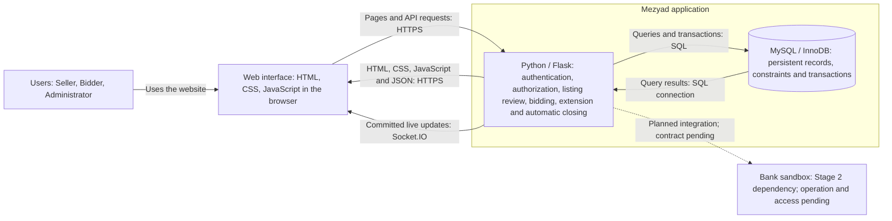

# Mezyad — Stage 3: Technical Documentation

نسخة التجربة الخاصة في testing-mz، مبنية على ملاحظات الفريق والمشرف.

نسخة مقترحة للمراجعة، 10 أكتوبر 2026. قرأت ملفات الريبو الستة عند commit `57929bf0942be798a4aa7527827b88f5b25d88fc`. الريبو وثائق تخطيط؛ الرسومات ليست وصفًا لكود موجود أو شهادة اختبار التطبيق. مصدر ملاحظات المشرف هو الملخص الذي أرسلته غادي.

## القرارات التي تجمع ملاحظاتكم

| الملاحظة | الناتج |
|---|---|
| الأعلى يفوز دائمًا | الخادم يختار أعلى مبلغ مسجل عند النهاية النهائية بعد التمديد. لا توجد شاشة أو API لاختيار الفائز يدويًا. |
| الحفاظ على المزاد الخاص | PUBLIC/PRIVATE في auctions، وصلاحية لكل مستخدم ومزاد في private_auction_access. قواعد الفوز واحدة. |
| آليات الموقع حلال | معلومات صادقة وقواعد معلنة ومنع رفع البائع لسعره. لا نضيف مزايدات وهمية أو رسوم محاولة أو مدفوعات جديدة. يوافق البائع على قواعد الفوز قبل النشر. هذه ضوابط تصميم وليست اعتمادًا شرعيًا لكل تفاصيل العقد. |
| أدوات نفهمها | غادي أكدت خبرة Python/Flask/MySQL/JavaScript واستثنت Express؛ التوصية Flask + MySQL + HTML/CSS/JavaScript. |
| أدوات كثيرة دون حاجة | تطبيق واحد وقاعدة واحدة. نستغني عن Redis والميكروسيرفسز والكاش الموزع في MVP. |
| تحديث مباشر وتمديد | نحافظ على Stage 2: POST لحفظ Bid، ثم Flask-SocketIO لإشعار الصفحات بعد commit. المكتبة تحتاج تجربة وفهمًا قبل الدمج. |
| Docker | Compose يشغل app وdb، بشبكة مشتركة وvolumes للبيانات والصور. |
| فروع لكل عضوة ثم دمج | فرع لكل مهمة وPR ومراجعة عضوة أخرى إلى development، ثم إصدار مراجع إلى main. |
| العلاقات والكلاسات | أسماء ثابتة بين SQL وERD ووصف الكلاسات والـAPI. الأدوار قيم في User وليست كلاسات موروثة. |
| برنامج تقني للرسم | الرسومات الخمس ككود Mermaid داخل هذا الملف وتعرض مباشرة في GitHub. Figma لشاشات الموقع. |

المعيار ليس قلة الجداول وحدها؛ كل أداة وسهم وجدول يجب أن يقابل مسؤولية يستطيع الفريق تطبيقها وشرحها.

## المعمارية ومسؤولية الأدوات

المعمارية المقترحة تطبيق ويب واحد بتنظيم مسؤوليات داخله (layered monolith): عرض الواجهة، قواعد العمل، والوصول للبيانات. هذا نمط عام موثق، وليس افتراض أنكم تبنون نظامًا موزعًا. استفدت من مبادئ C4 في تسمية العنصر ومسؤوليته وتقنيته وتسمية الأسهم، مع فصل تفاصيل Docker والنشر. الرسم ليس ادعاء تطبيق كل مستويات C4، ولا أن التاسك يفرض C4.

هذه الوثيقة تحتوي خمسة مخططات مطلوبة بصيغة Mermaid: Architecture واحد، ERD واحد، وثلاثة Sequence Diagrams. وصف الكلاسات جدول هنا، وSCM وDocker وQA خطط نصية. لا توجد رسومات إضافية لها في النسخة المسلمة.

المتصفح يعرض HTML/CSS/JavaScript ويطلب Flask عبر HTTP. Flask يتحقق من الهوية والصلاحية وقواعد العمل، ثم يقرأ ويكتب MySQL. الأحداث المباشرة ترجع من التطبيق إلى المتصفحات بعد الحفظ. لا يتصل المتصفح مباشرة بقاعدة البيانات، ولا يقرر السعر أو الفائز.

داخل تطبيق Flask: routes، نماذج SQLAlchemy إذا استخدم الفريق ما درسه منه، AuctionService للمزايدة والإغلاق، وظائف مراجعة الإعلان، وظائف المساعد، ووحدة البنك عند تحديد العملية. هذه أجزاء تطبيق واحد وليست خدمات مستقلة.

Socket.IO يخدم عرض السعر والوقت في صفحة المزاد نفسها. لا يحل محل SQL أو transaction. تشغيل MVP بعملية تطبيق واحدة وعامل خادم واحد يدعم threads؛ يمكن استخدام Gunicorn threaded مع simple-websocket داخل حاوية Linux. لا نضيف عدة نسخ تطبيق دون مراجعة توزيع الأحداث ومهمة الإغلاق. لا نستخدم Flask development server كخطة production.

المساعد يحتفظ بوظائفه الست: اقتراح العنوان، نقص الحقول، بحث العام، ملخص النشاط، خط المزايدات الزمني، وملخص المزاد. تنفيذها قواعد واستعلامات؛ لا تتطلب خدمة AI خارجية.

### Architecture Diagram



الخط المنقط اعتماد خارجي لم يُحسم عقده. Docker وGitHub موضحان في خطة SCM والنشر، ولا يتوسطان طلبات المستخدم.

## قواعد المزاد والحالات

1. الأدوار الحالية BIDDER وSELLER وADMIN، دور واحد للحساب. التسجيل العام لا يسمح بإنشاء ADMIN.
2. الإعلان PENDING_REVIEW ثم APPROVED أو REJECTED. يبدأ حفظ البيانات ثم رفع الصور؛ لا يعرض في طابور المراجعة ولا يعتمد إلا بعد اكتمال الحقول وصورة واحدة على الأقل. البائع يعدل إعلانًا أعيد له ثم يعيد إرساله؛ تمسح حقول المراجعة الحالية وتعود الحالة PENDING_REVIEW.
3. ينشأ المزاد لإعلان APPROVED يملكه البائع فقط. لكل إعلان صفر أو مزاد واحد في MVP؛ إعادة المزاد للإعلان نفسه خارج هذه النسخة.
4. الخاص له رمز مخزن كـhash. بعد التحقق الآلي يسجل الوصول الخاص للمستخدم والمزاد. لا توجد موافقة بشرية على Bid.
5. صلاحية الخاص تشمل الإعلان والصور والمساعد والانضمام لقناة التحديث، بالإضافة إلى صفحة المزاد. المالك والمشرف لهما صلاحية عملهما.
6. الالتزام منفصل عن الوصول الخاص، ولكل مزايد ومزاد. لا يثبت الجدية أو القدرة المالية؛ عملية البنك لم تُحسم.
7. أول مبلغ ≥ starting_price. كل مبلغ لاحق ≥ أعلى مبلغ مسجل + minimum_increment. لا تسجل مبالغ متساوية، ولا يختار شخص بين المزايدات.
8. إذا سجلت مزايدة قبل النهاية وكان المتبقي ≤ 60 ثانية، يصبح end_time = وقت قرار الخادم + 60 ثانية. يتكرر التمديد عند تحقق الشرط.
9. وقت الخادم هو المرجع؛ عداد المتصفح للعرض. عند النهاية النهائية يفوز الأعلى تلقائيًا. عند عدم وجود مزايدات تحفظ نتيجة بلا winning_bid_id.
10. لا يوجد تعديل أو حذف للمزايدات المسجلة والنتيجة، ولا تعديل لبيانات الأصل المنشور خلف المزايدين.

## قاعدة البيانات والعلاقات

SQL يستهدف MySQL 8.4/InnoDB؛ المخطط الكامل في [schema.sql](schema.sql). تسعة جداول؛ جلسة Flask الموقعة لا تحتاج جدول user_sessions. الدور الحالي يقرأ من users في الخادم. لا تحفظ أسرار المزاد أو بيانات البنك في cookie.

| الجدول | المسؤولية |
|---|---|
| users | الحساب والدور وكلمة المرور كـhash. |
| categories | الفئات نفسها في الواجهة والـAPI والبيانات التجريبية: سيارات وعقارات وإبل ولوحات. |
| items | الأصل وبائعه وفئته ومعلوماته وحالة وآخر ملاحظات المراجعة. |
| item_images | صورة ومسارها وترتيبها لكل إعلان؛ عدة صور للأصل. |
| auctions | النوع والوقت والشروط والسعر الحالي. البائع يستخرج من item ولا يكرر هنا. |
| private_auction_access | صلاحية user لمزاد خاص، بمفتاح مركب. |
| bid_commitments | التزام bidder بمزاد، بمفتاح مركب. |
| bids | سجل كل مبلغ وصاحبه ومزاده ووقته ومعرف إعادة الطلب. |
| auction_results | نتيجة واحدة للمزاد، تربط winning_bid_id. الاسم والمبلغ يستخرجان من Bid/User. |

في ERD: || تعني واحدًا إلزاميًا؛ o| و|o تعنيان صفرًا أو واحدًا؛ o{ تعني صفرًا أو عدة. الخط المتصل علاقة identifying تدخل فيها هوية الأب في مفتاح الابن، والمنقط علاقة non-identifying. هذه خطوط علاقات بيانات وليست رسائل شبكة.

| العلاقة | التفسير الصحيح |
|---|---|
| User—Item (seller) | لكل Item بائع واحد؛ User له صفر أو عدة إعلانات. |
| User—Item (reviewer) | للإعلان صفر أو مراجع واحد قبل/بعد المراجعة؛ المشرف يراجع عدة إعلانات. |
| Category—Item | للإعلان فئة واحدة؛ الفئة تحتوي صفر أو عدة إعلانات. |
| Item—ItemImage | الصورة تخص إعلانًا واحدًا. قد يبدأ سجل الإعلان بلا صور أثناء الإدخال؛ التطبيق يشترط صورة قبل إرساله للمراجعة. |
| Item—Auction | لكل Auction إعلان واحد؛ Item له صفر أو مزاد واحد. UNIQUE(item_id). |
| User/Auction—PrivateAuctionAccess | كل صف يربط مستخدمًا واحدًا ومزادًا واحدًا، وPK الزوج يمنع التكرار. لا نلزم العام بهذا السجل. |
| User/Auction—BidCommitment | سجل واحد لكل زوج مزايد/مزاد، وليس سجلًا لكل Bid. |
| User/Auction—Bid | لكل Bid مزايد واحد ومزاد واحد؛ كل منهما له صفر أو عدة Bids. |
| BidCommitment—Bid | FK مركب يربط الالتزام بنفس bidder وauction. الخادم يفحص COMMITTED؛ وجود الصف وحده لا يكفي. |
| Auction—AuctionResult | صفر أو نتيجة واحدة أثناء دورة الحياة. التطبيق ينشئ واحدة عند الإغلاق؛ PK(auction_id) يمنع نتيجتين. |
| Bid—AuctionResult | صفر أو Bid فائز لكل نتيجة بسبب حالة بلا مزايدات. كل Bid فائز في صفر أو نتيجة واحدة. FK مركب يمنع Bid من مزاد آخر. |

SQL لا يثبت أن user بائع أو مشرف، ولا أن winning_bid هو الأعلى. FK يثبت وجود المرجع؛ الخادم يفحص الأدوار والحالات ويحسب الفائز داخل transaction.

حقول NULL: reviewed_by/reviewed_at قبل المراجعة؛ review_notes لازمة عند REJECTED؛ access_code_hash للخاص فقط؛ current_price قبل أول Bid؛ winning_bid_id عند الإغلاق بلا مزايدات فقط. المبلغ DECIMAL(18,2)، وDecimal في Python، ونص في JSON. IDs أعداد INT؛ request_id UUID لكل محاولة إرسال؛ الأوقات UTC.

UNIQUE(auction_id,bidder_id,request_id) يمنع إعادة حفظ الطلب نفسه. إعادة نفس المفتاح بمبلغ مختلف conflict. UNIQUE(auction_id,amount) يمنع التعادل المسجل، لكنه لا يكفي للتحقق من أقل زيادة. السعر الحالي قيمة مشتقة تحدث في transaction مع Bid؛ لا تقبل من المتصفح.

category_fields يحتفظ بخصائص صغيرة متغيرة حسب الفئة كـJSON؛ لا يحوي العلاقات أو الملكية أو السعر. السيارات: make/model/year/mileage/condition؛ العقارات: propertyType/area/bedrooms/condition، والموقع في items.location. حقول الإبل واللوحات تستكمل من النماذج الفعلية قبل إنهاء هذا القسم، ولا تختلق. الصور تحفظ خارج static وتقدم عبر route يفحص الوصول.

### Database ER Diagram


المفاتيح المركبة توضح في SQL: PK للزوج في access/commitments، وFK للالتزام بنفس auction/bidder، وFK للنتيجة بنفس auction/winning_bid. PK(auction_id) يمنع نتيجتين للمزاد. الاختيار الأعلى وصلاحيات الأدوار مسؤولية الخادم.

## الكلاسات ومكونات الواجهة

| Class → table | خصائص أساسية | Methods |
|---|---|---|
| User → users | id,name,email,password_hash,role | set_password(), check_password() |
| Category → categories | id,code,name | لا قواعد مستقلة تحتاج methods مصطنعة. |
| Item → items | seller_id,category_id,title,status,reviewed_by,category_fields | can_edit(), resubmit() |
| ItemImage → item_images | id,item_id,image_path,display_order | الرفع والتحقق في route/helper. |
| Auction → auctions | item_id,visibility,status,starting_price,current_price,minimum_increment,start_time,end_time | is_open(now), minimum_next_amount() |
| PrivateAuctionAccess → private_auction_access | auction_id,user_id,granted_at | لا business methods مستقلة. |
| BidCommitment → bid_commitments | auction_id,bidder_id,status | is_committed() |
| Bid → bids | id,auction_id,bidder_id,amount,request_id,created_at | سجل ثابت، لا update/delete. |
| AuctionResult → auction_results | auction_id,winning_bid_id,closed_at | نتيجة ثابتة؛ لا choose_winner(). |
| AuctionService — لا table | db_session | ensure_access(), place_bid(), close_if_due() |

AuctionService يعتمد على النماذج. ليس User والدور BIDDER وراثة أو تركيبًا. طرق Item تغير الحالة بعد فحص الملكية. قرار حفظ Bid يستخدم قراءة مقفلة داخل المعاملة، وليس نتيجة is_open من قراءة قديمة.

الواجهة: AuthenticationForm، AuctionList، AuctionDetails، PrivateAccessForm، CommitmentPanel، BidForm، BidHistory، AuctionResultPanel، ListingForm، ReviewPanel، AssistantPanel. هي أقسام HTML/JS؛ لا تعني استخدام React. السعر والعداد والنموذج والسجل والنتيجة في صفحة المزاد نفسها. بعد انقطاع الاتصال يجلب المتصفح snapshot من GET؛ الأحداث ليست مصدر الحقيقة.

## تسلسلات العمليات الثلاثة

1. الإعلان → مراجعة المشرف → إنشاء المزاد. عند REJECTED: ملاحظات ثم PATCH وresubmit؛ لا ينشر إعلان غير معتمد. مخطط النجاح لا يخفي هذا الفرع الموثق.
2. دخول خاص → التزام مكتمل → POST للمزايدة → lock/validation/save/commit → تحديث السعر والنهاية. للعام تتجاوز خطوة الرمز فقط. البنك مرحلة منفصلة لم يحدد عقدها، وليس استدعاء داخل قفل Bid.
3. مهمة داخل التطبيق → lock وفحص الموعد الحالي → أعلى Bid أو لا Bid → كتابة CLOSED ونتيجة واحدة → حدث الإغلاق. التمديد يجعل المهمة تنتظر الموعد الجديد.

مهمة داخلية واحدة كل ثانية في عملية التطبيق الواحدة، ولا تحتاج متصفحًا مفتوحًا. تنقل SCHEDULED إلى ACTIVE عند start_time، وتغلق المزاد عند end_time الحالي، بقفل صفه داخل المعاملة. تستدرك المزادات المنتهية بعد restart؛ إذا فات وقت البداية والنهاية تغلقه مباشرة. GET وPOST يتحققان من الوقت الحالي ويستخدمان close_if_due كفحص إضافي؛ حالة ACTIVE وحدها لا تسمح بالمزايدة بعد الموعد. يمنع تشغيل المهمة مرتين بسبب development reloader.

place_bid: الهوية من الجلسة → transaction وقفل صف Auction → كشف إعادة الطلب → قراءة وقت UTC جديد بعد الحصول على القفل → فحص الوقت والوصول والالتزام والمبلغ → حفظ Bid وتحديث السعر والنهاية → commit → بث الحدث. close_if_due يقفل الصف نفسه. يجب اختبار تزامن المزايدة والإغلاق؛ وضع كلمة transaction في الرسم لا يثبت الصحة.

### Sequence 1 — Listing review and publication

```mermaid
sequenceDiagram
    actor seller as Seller browser
    participant app as Flask application
    participant db as MySQL
    actor admin as Admin browser

    seller->>app: Submit listing details and upload images
    app->>db: Store PENDING_REVIEW item and image references
    db-->>app: Stored listing
    app-->>seller: Listing ID and review state
    admin->>app: Review listing with decision and notes
    app->>app: Check ADMIN role and complete listing including image

    alt Approved listing
        app->>db: Save APPROVED and reviewer fields
        db-->>app: Review saved
        app-->>admin: Approval confirmation
        seller->>app: Create PUBLIC or PRIVATE auction
        app->>app: Check seller owns APPROVED item and stated rules
        app->>db: Insert auction and private code hash if applicable
        db-->>app: Auction saved
        app-->>seller: Auction ID and stated rules
    else Rejected listing
        app->>db: Save REJECTED with required feedback
        db-->>app: Review saved
        app-->>admin: Rejection confirmation
        seller->>app: Read feedback, edit listing and resubmit
        app->>app: Check ownership, editable state and complete data
        app->>db: Update item, clear reviewer fields, set PENDING_REVIEW
        db-->>app: Resubmission saved
        app-->>seller: Waiting for a new review
    end
    Note over app,db: The admin reviews the listing; no person chooses the winning bid.
```

### Sequence 2 — Private access and bidding

```mermaid
sequenceDiagram
    actor bidder as Bidder browser
    participant app as Flask / AuctionService
    participant db as MySQL
    participant viewers as Authorized auction browsers

    Note over bidder,app: Authenticated BIDDER; commitment is completed in a separate flow.
    opt PRIVATE auction with valid code
        bidder->>app: POST access with code
        app->>db: Read auction visibility and stored code hash
        db-->>app: Auction access configuration
        app->>app: Verify code and attempt limit
        app->>db: Insert user-auction access if absent
        db-->>app: Access grant saved
        app-->>bidder: Access granted
    end
    Note over bidder,app: A wrong private code returns an error and creates no grant.

    bidder->>app: POST bids with amount and request_id
    app->>db: BEGIN and SELECT auction FOR UPDATE
    db-->>app: Locked current auction state
    app->>db: Check request_id and read access and commitment
    db-->>app: Existing request or eligibility records

    alt Matching request_id and amount already saved
        app->>db: End transaction without a new write
        app-->>bidder: 200 with original Bid
    else New request or conflicting payload
        app->>app: Read fresh UTC time; validate role, access, COMMITTED, amount and deadline
        alt Invalid request, low amount, expired time or changed retry amount
            app->>db: ROLLBACK; no Bid or price change
            app-->>bidder: Error with reason
        else Eligible higher bid before end_time
            app->>app: Compute price and any anti-sniping extension
            app->>db: Insert Bid; update price and end_time; COMMIT
            db-->>app: Saved state
            app-->>bidder: 201 Bid confirmation
            app-->>viewers: Socket.IO auction_updated after commit
        end
    end
    Note over app,db: First Bid reaches starting_price; later Bid reaches highest amount plus minimum_increment.
    Note over app,db: At most 60 seconds remaining extends end_time to decision time plus 60 seconds.
```

### Sequence 3 — Automatic closing

```mermaid
sequenceDiagram
    participant timer as Internal closing task
    participant app as AuctionService
    participant db as MySQL
    participant viewers as Authorized auction browsers

    timer->>app: Check due auctions every second
    app->>db: BEGIN and SELECT auction FOR UPDATE
    db-->>app: Locked state and current end_time
    app->>app: Read fresh UTC time and check deadline

    alt Already CLOSED or end_time not reached
        app->>db: End transaction without a new result
    else Final end_time reached
        app->>db: SELECT highest Bid WHERE auction_id matches
        db-->>app: Maximum amount Bid or no Bid
        app->>app: Set winning_bid_id to highest Bid ID or NULL
        app->>db: Save CLOSED and one AuctionResult; COMMIT
        db-->>app: Closure saved
        app-->>viewers: Socket.IO auction_closed after commit
        viewers->>app: GET result with current session
        app->>app: Check authorization for this auction
        app->>db: Read result and winning Bid
        db-->>app: Stored result
        app-->>viewers: Winning amount and caller-specific is_current_user_winner
    end
    Note over app,db: Highest recorded amount always wins; no bids means a NULL winning reference.
    Note over timer,app: An extension postpones closing; restart checks overdue auctions again.
```

## User Stories وMockups

| MoSCoW | User Story |
|---|---|
| Must | As a user, I want to sign in securely, so that I can use the functions allowed for my role. |
| Must | As a seller, I want to submit an asset listing, so that an administrator can review its information before publication. |
| Must | As a seller, I want to revise and resubmit a returned listing, so that I can correct its information. |
| Must | As an administrator, I want to approve or return a listing with feedback, so that published assets have clear information. |
| Must | As a seller, I want to create a public or private auction with stated rules, so that authorized bidders can compete fairly. |
| Must | As a bidder, I want to verify a private code and complete commitment, so that I can participate in that auction. |
| Must | As a bidder, I want to place higher bids and see live price/time updates on one page, so that I can follow the auction. |
| Must | As a bidder, I want late bids to extend the stated end time, so that participants have time to respond. |
| Must | As a participant, I want the highest recorded bid to win automatically at the final deadline, so that the result follows the rules. |
| Should | As a user, I want assistant suggestions and summaries, so that I can understand listings and auction activity. |
| Could | As a bidder, I want extra public search filters, so that I can narrow results. |
| Won't | Online payments, escrow, invoicing, delivery, paid bidding attempts, distributed infrastructure and external generative AI. |

Should للمساعد ترتيب تنفيذ بعد الجوهر، وليس حذفًا لمتطلب Stage 2. روابط الواجهة الحالية: [Figma UI Prototype](https://www.figma.com/proto/mbc0Qc5e0hR8dIaqQjbMMN/Mezyad-1?node-id=2-2&starting-point-node-id=2%3A2) و[Figma Make](https://www.figma.com/make/kPPjEPSCp5baGlCi8Lz2o4/Mezyad-1?t=Z7jnPTxHHkYSNbgS-20&fullscreen=1).

Mockups الحالية في Figma والسيناريوهات السبعة تبقى مرجع الواجهة، ومنها إعادة الإعلان وإغلاق مزاد بلا مزايدات. لا يحل ERD محل mockups.

## API المقترح

JSON للأعمال المعتادة، multipart للصور، cookie session وحماية CSRF لطلبات التغيير. user IDs للعمل مشتقة من الجلسة؛ لا يرسل المتصفح seller_id أو bidder_id أو reviewed_by أو current_price أو الفائز. لا ينشئ تسجيل الحساب ADMIN.

| Method / Path | Input | Output / access |
|---|---|---|
| POST /api/v1/auth/register | name,email,password,role=SELLER/BIDDER | 201: id,name,role |
| POST /api/v1/auth/login | email,password | 200: user + session cookie |
| POST /api/v1/auth/logout | فارغ | 204 |
| GET /api/v1/auth/me | فارغ | user أو 401 |
| GET /api/v1/categories | فارغ | categories[] |
| POST /api/v1/items | category_id,title,description,location,category_fields | 201: item/status؛ SELLER، استكمال الصور قبل المراجعة |
| GET /api/v1/items/{id} | path | item؛ مالك/ADMIN أو عبر مزاد يحق للمستخدم رؤيته |
| PATCH /api/v1/items/{id} | الحقول المعدلة | item؛ المالك وREJECTED فقط |
| POST /api/v1/items/{id}/images | file | 201: image؛ المالك قبل الاعتماد/النشر |
| GET /api/v1/item-images/{id} | path | الصورة بعد فحص الوصول |
| POST /api/v1/items/{id}/resubmit | فارغ | PENDING_REVIEW بعد اكتمال الحقول وصورة واحدة على الأقل |
| GET /api/v1/admin/items?status= | query | items[]؛ ADMIN، لا يدخل ناقص الصور في قائمة المراجعة |
| POST /api/v1/items/{id}/review | decision,notes | item/status؛ ADMIN؛ notes لازمة للرفض |
| POST /api/v1/auctions | item_id,visibility,starting_price,minimum_increment,start_time,end_time,access_code للخاص | 201: auction؛ مالك Item APPROVED |
| GET /api/v1/auctions?category_id=&q= | query | public auctions[]؛ الدخول مطلوب كما في Stage 2 |
| GET /api/v1/auctions/{id} | path | auction,item,bids,server_time؛ فحص الخاص |
| POST /api/v1/auctions/{id}/access | code | access_granted؛ BIDDER، تحقق رمز مع حد للمحاولات |
| POST /api/v1/auctions/{id}/commitment | يعتمد على عملية البنك المختارة | commitment.status؛ العقد غير نهائي |
| POST /api/v1/auctions/{id}/bids | amount كنص,request_id UUID | 201: bid,auction؛ 200 لإعادة مطابق؛ ملتزم ومصرح |
| GET /api/v1/auctions/{id}/result | path | status,winning_bid_id/amount nullable,is_current_user_winner؛ 409 قبل الإغلاق |

400 مدخل غير صالح، 401 دخول، 403 صلاحية، 404 غير موجود، 409 تعارض الحالة/السعر/إعادة الطلب. قالب الخطأ: `{ "error": { "code": "BID_TOO_LOW", "message": "..." } }`.
طلب Bid: `{ "amount": "1500.00", "request_id": "6a550a11-14e0-4fa2-9806-e8a5d7fbfc23" }`.
استجابة: `{ "bid": { "id": 42, "auction_id": 7, "amount": "1500.00" }, "auction": { "current_price": "1500.00", "end_time": "2026-10-10T15:01:00Z" } }`.
بلا مزايدات: `{ "status": "CLOSED", "winning_bid_id": null, "winning_amount": null, "is_current_user_winner": false }`.

Socket.IO: join_auction {auction_id} يفحص الجلسة والوصول ويعيد snapshot. auction_updated {auction_id,current_price,end_time,status} وauction_closed {auction_id,status} بعد commit. عند الإغلاق يجلب كل مستخدم GET result؛ لا نبث قيمة is_current_user_winner الشخصية للجميع. لا تستخدم Socket.IO لكتابة المزايدة بدل POST.

المساعد: POST `/api/v1/assistant/title` و`/missing-fields` ببيانات الإعلان للمالك؛ GET `/api/v1/assistant/search?q=` للعام؛ GET `/api/v1/auctions/{id}/assistant/activity-summary` و`/bid-timeline` و`/auction-summary` لمن يملك الوصول. النتائج title/missing_fields/auctions/summary/timeline حسب الوظيفة؛ يستكمل عقد الحقول مع تعريف الفئات.

Stage 2 يطلب Saudi Open Banking sandbox ويذكر SABB وAl Rajhi بديلًا. لا عقد عملية أو وصول مثبت في الريبو. يجب اختيار عملية موثقة ومدخلها ومخرجها وأثرها على الالتزام، أو تعديل المتطلب مع الموجه. لا نختلق endpoint أو نزعم اكتمال الربط. mock أثناء التطوير لا يثبت نجاح التكامل الخارجي.

## SCM وDocker والنشر

development → فرع المهمة → commits صغيرة → Docker محلي + اختبارات → push → PR إلى development → مراجعة عضوة أخرى → merge → اختبار التكامل → PR إلى main → staging ثم production.

أمثلة فروع وليست توزيعًا مفروضًا: feature/ghadi-auction-page، feature/aseel-auth، feature/tala-bidding، feature/abeer-data-model. الفرع لمهمة، وليس فرعًا دائمًا لكل أعمال العضوة. تعالج التعارضات في فرع المهمة ثم يعاد الاختبار المتأثر. المراجعة تشمل المنطق والصلاحيات وتطابق API.

ملفات مخططة: Dockerfile، compose.yaml، requirements.txt، .env.example، .gitignore، migrations. .env والأسرار والصور وبيانات db لا تدخل Git. DB_HOST=db داخل app؛ localhost هناك لا يشير لحاوية MySQL. لا ينشر منفذ db خارج شبكة Compose عادة. volume db_data للقاعدة وuploads للصور. ينتظر app جاهزية db؛ migrations خطوة موثقة مرة واحدة، وseeds لبيئة الاختبار فقط.

نشر يدوي منظم مناسب: commit إصدار → backup → build/run على host يدعم Docker → migrations → فحص login/private/bid/closure → اعتماد الإصدار. staging وproduction بقواعد وsecrets وvolumes مستقلة، وHTTPS من الاستضافة. فشل staging يمنع production. rollback يراجع توافق migration مع الإصدار السابق. الاستضافة لم تحدد، فلا نزعم pipeline مكتملًا. GitHub يحفظ ويراجع الكود؛ GitHub Pages لا يشغل Flask/MySQL.

## QA

| النوع | الحالات | الأداة |
|---|---|---|
| Unit | أول مبلغ، الزيادة، التمديد، الأعلى، بلا مزايدات، نقص حقول | pytest |
| Integration | FKs، result من مزاد آخر، الهوية والأدوار، إعادة الإعلان، الالتزام | pytest + Flask test client + MySQL اختبار |
| API | inputs/outputs/status وإعادة request_id | Postman |
| Concurrency | اتصالان منفصلان يزايدان؛ سباق التمديد والإغلاق | تكامل MySQL واتصال لكل thread |
| Manual UI | RTL، الصور، رمز خاطئ، تحديث متصفحين، انقطاع، فوز/خسارة/بلا مزايدات | متصفحات وحسابات مختلفة |
| Privacy | item/image/assistant/socket لمزاد خاص بلا صلاحية | API ويدوي |
| Restart | استدراك الإغلاق وبقاء البيانات والصور | Docker ويدوي |
| Sandbox | نجاح/مهلة/فشل العملية الحقيقية وأثرها | بعد اختيار العملية، وليس mock فقط |

يسجل المتوقع والفعلي والنتيجة والمختبرة والإصدار. عند اكتمال التسليم يطلب الفريق Manual QA review من منصة هولبرتون. لم ينفذ أو يطلب هذا التقييم هنا.

## ما لم يُحسم بعد

عملية البنك؛ حقول الإبل واللوحات؛ الاستضافة الفعلية؛ وتوحيد تصفح العام قبل الدخول. هذه النسخة تحافظ على اشتراط الدخول في Stage 2؛ إذا اخترتم التصفح العام قبل الدخول يعدل Stage 2 والـAPI والقصص معًا. لا نحذف وظائف Stage 2 بصمت. يبقى الجدول الزمني: توثيق الأسابيع 4–5 وتطوير 6–10 واختبار 11–12 كما في Stage 2.

قبل البناء الكبير، ينفذ الفريق تجربة يفهمها: حسابان ومتصفحان، مزايدتان متزامنتان، تمديد، إغلاق وفوز الأعلى. لا نعلن صحة التنفيذ قبل تجربته على MySQL.

schema.sql ورسومات Mermaid هنا هما المقترح الحالي. حفظ التقرير الأصلي في Original_Report.MD للرجوع إليه. الملفات في هذا الريبو نسخة تجربة خاصة؛ الريبو الأساسي وشاشات Figma الأصلية لم تتغير.

## مراجع رسمية

- [GitHub: Creating diagrams](https://docs.github.com/en/get-started/writing-on-github/working-with-advanced-formatting/creating-diagrams): عرض Mermaid داخل Markdown.
- [Mermaid ERD](https://mermaid.js.org/syntax/entityRelationshipDiagram.html) و[Sequence](https://mermaid.js.org/syntax/sequenceDiagram.html): صيغة العلاقات والتسلسلات.

- [draw.io ERD](https://www.drawio.com/docs/diagram-types/entity-relationship-tables/) و[UML](https://www.drawio.com/docs/diagram-types/uml/): الرسم التقني؛ صحة المحتوى مسؤولية التصميم. التاسكات المرسلة لا تفرض برنامجًا تقنيًا واحدًا.
- [C4: Container diagram](https://c4model.com/diagrams/container) و[Notation](https://c4model.com/diagrams/notation): مستوى واضح للعناصر والمسؤوليات والتقنيات وأسهم مسماة؛ تفاصيل النشر تعرض منفصلة. كلمة container في C4 لا تعني حاوية Docker.
- [Microsoft: Common web application architectures](https://learn.microsoft.com/en-gb/dotnet/architecture/modern-web-apps-azure/common-web-application-architectures): إمكانية تنظيم طبقات داخل تطبيق ينشر كوحدة واحدة؛ الاستفادة هنا من النمط العام، لا اختيار ASP.NET.
- [Flask: project layout](https://flask.palletsprojects.com/en/stable/tutorial/layout/) و[templates](https://flask.palletsprojects.com/en/stable/tutorial/templates/): ملفات الواجهة والـroutes والبيانات يمكن تنظيمها داخل تطبيق Flask واحد.
- [Mermaid](https://mermaid.js.org/intro/) و[PlantUML](https://plantuml.com/): بدائل رسم نصية.
- [MySQL locking reads](https://dev.mysql.com/doc/refman/8.4/en/innodb-locking-reads.html): قفل الصف أثناء معاملة المزايدة.
- [Flask-SocketIO deployment](https://flask-socketio.readthedocs.io/en/latest/deployment.html): threaded بعامل واحد، وتوزيع الأحداث عند تعدد الخوادم.
- [Docker Compose](https://docs.docker.com/compose/intro/compose-application-model/): الخدمات والشبكة والـvolumes.
- [GitHub Pages](https://docs.github.com/en/pages/getting-started-with-github-pages/what-is-github-pages): استضافة ثابتة.
- [قرار مجمع الفقه الإسلامي الدولي بشأن المزايدة](https://iifa-aifi.org/ar/1958.html): المبادئ العامة وتحريم النجش، وليس اعتمادًا لكل تفاصيل الموقع.
